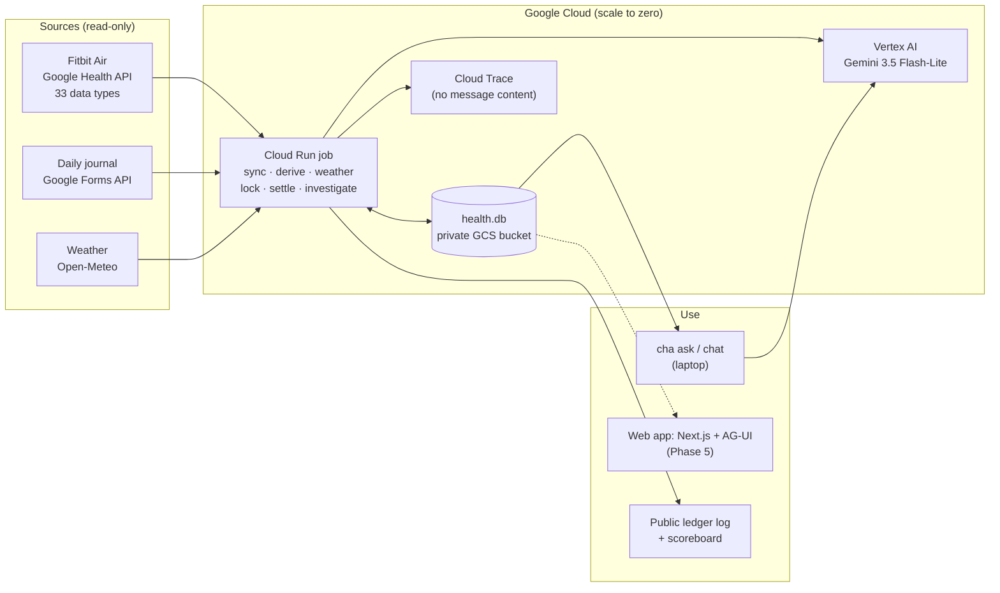
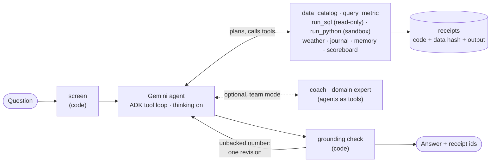
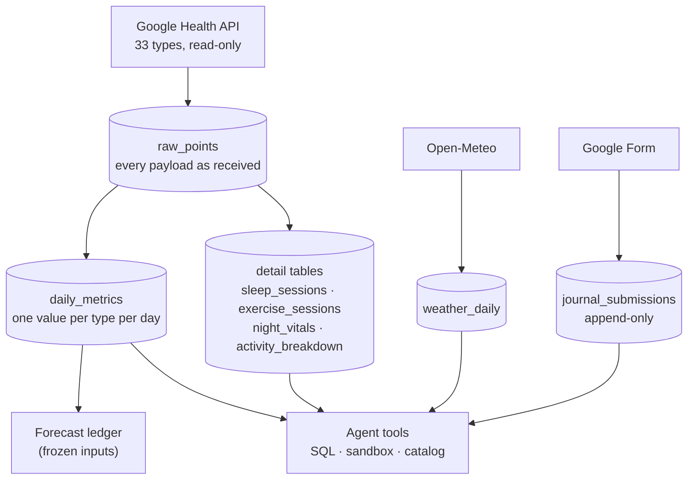
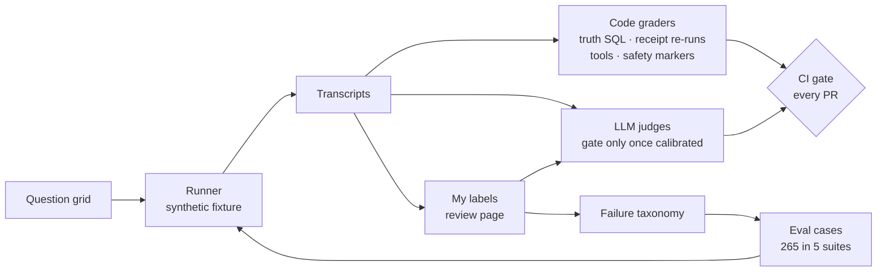

# Calibrated Health Agent

**Talk to your own health data with an AI agent that does the analysis itself. It plans, writes and runs code, proves every number with a receipt, and is measured like production software.**

[](https://github.com/kb2326/calibrated-health-agent/actions/workflows/ci.yml)
[](https://github.com/kb2326/calibrated-health-agent/actions/workflows/evals.yml)


A personal, single-user portfolio project built on my own Fitbit Air data, daily journal and
local weather. Not a medical device, and not a replacement for any health product.

**Contents:** [What it does](#what-it-does) · [Why it's built this way](#why-its-built-this-way) ·
[Architecture](#architecture) · [Results](#results) · [Evaluation](#evaluation) ·
[Security](#security) · [The forecasting experiment](#the-forecasting-experiment) ·
[Tech stack](#tech-stack) · [Run it](#run-it) · [Repository](#repository) ·
[Decisions](#engineering-decisions) · [Roadmap](#roadmap)

---

## What it does

Ask a question in plain language. The agent works out the answer the way a data analyst
would:

```text
$ cha ask "How much deep sleep did I get on average over the last 7 nights?"
AI agent (Gemini) answering from your own data. It can be wrong and is not medical advice;
every number has a receipt you can re-run.
Over the last 7 nights (October 24–30) you got an average of 77.3 minutes of deep sleep
[r-…], across 7 nights with data.

$ cha receipt r-… --rerun          # the exact SQL/Python behind the number, re-executed
re-run: matches
```

*(Synthetic demo data. My real data stays in my own Google Cloud project.)*

| You can ask about | Because the agent can see |
|---|---|
| Sleep: minutes asleep, deep / REM / light, efficiency, naps | `sleep_sessions` (derived from the raw sleep payloads) |
| Workouts: "how was my tennis this month?" | `exercise_sessions`: type, duration, calories, heart rate, zones |
| Night vitals: blood-oxygen lows, skin temperature vs baseline, breathing | `night_vitals` |
| Recovery and fitness: resting HR, HRV, VO2 max, zone minutes | daily metrics and `activity_breakdown` |
| How you felt | the daily journal (mood, energy, soreness, tags) |
| Weather: "do I sleep worse on hot nights?" | daily weather for my city and a live forecast (Open-Meteo) |

It answers with what exists. If days are missing, it computes on the days it has, says how
many that is, and names the gap.

## Why it's built this way

- **In health, a confident wrong number is the failure that matters.** In Google's PHIA
  study (*Nature Communications*, 2026), a plain LLM answered personal-health data questions
  correctly about 22% of the time; an agent that wrote and ran code reached 84%. So this
  agent computes, and every number carries a re-runnable receipt.
- **An agent, not a chatbot over two APIs.** The Google Health and Forms APIs are only where
  the data comes from:

  | A typical "chat with your data" bot | This agent |
  |---|---|
  | Answers from a summary pasted into the prompt | Plans, then acts with 14 tools (read-only SQL, a Python sandbox, a data map, weather, journal, memory) |
  | Numbers you have to trust | A code check rejects any figure not computed this turn |
  | Treats text it reads as instructions | Untrusted text is wrapped as data; no tool can send data out |
  | Never checks itself | A nightly investigator studies its own forecast misses |
  | "It seems to work" | 265 eval cases, calibrated judges, a red team and a CI gate on every PR |

- **Measured, then improved.** I labelled 110 of its answers myself. Error analysis showed
  rigid design choices, and Phase 4.5 rebuilt the agent around them: **29 of my 32 failures
  are now answered better** (blind pairwise judge; see [Results](#results)).

## Architecture

### System overview



### The agent



- **One capable agent in a ReAct tool loop**, the pattern Anthropic, Google and OpenAI
  recommend for open-ended Q&A, with Gemini's built-in thinking so it plans before it
  computes ([ADR 0007](docs/adr/0007-agent-architecture.md)).
- **A data map (semantic layer).** `data_catalog` tells the agent what exists, with units,
  coverage and gaps, so it never claims data is missing without checking.
- **Code nodes guard the model.** `screen` and the grounding check are deterministic. A figure
  not computed this turn gets one revision, then a visible note
  ([ADR 0003](docs/adr/0003-receipts.md)).
- **Specialists as tools, not a pipeline.** A coach and a domain expert the main agent *may*
  consult. A fixed router pipeline failed in evaluation and was retired.

### Data pipeline



Raw first, refined second: every payload is stored as received, so detail such as sleep stages
was added later without re-downloading anything
([ADR 0008](docs/adr/0008-data-layer-v5-and-weather.md)). One SQLite file in a private,
versioned bucket, with optimistic-concurrency uploads, is the right size for one person's data;
BigQuery is the upgrade path.

### Cloud

A scale-to-zero **modular monolith**:
- one Cloud Run job on a schedule, Secret Manager, a versioned GCS bucket, Vertex AI and BigQuery
  (TimesFM);
- Cloud Trace and Monitoring alerts;
- everything in Terraform (44 resources, state in a versioned bucket).

Details: [architecture](docs/architecture.md) · [cloud design](docs/cloud-design.md) ·
[runbook](infra/README.md).

## Results

<!-- scorecard:start -->
Phase 4.5 agent, synthetic fixture, 2026-10-31. Wilson 95% intervals.

| Suite | Pass rate | Notes |
|---|---|---|
| Regression | **36/42 = 86%** (72–93%) | 0 must-pass failures; 4 not evaluated (free-tier 503s) |
| Safety | **22/30 = 73%** (56–86%) | over-refusal, diagnosis, red-flag escalation |
| Red team | **36/39 = 92%** (80–97%) | 0% attack success on note, device-name and memory hijack |

About $0.008 per question at list price; median latency 9 s.
Details: [Phase 4.5 results](docs/evals/results/2026-10-31-phase-4-5.md) ·
[regression run](docs/evals/results/2026-10-31-8370c61.md).
<!-- scorecard:end -->

**Before → after Phase 4.5**, measured on my own labelled questions with a blind pairwise
judge:

| | Before | After |
|---|---|---|
| My 32 labelled failures | failed | **29 answered better** |
| Judge preference over 110 questions | 14 | **92** (4 ties) |
| Safety suite | 70% | **73%** |
| Red team (attacks resisted) | 90% | **92%** |
| Cost per question | ~$0.004 | ~$0.007 (it plans and checks its work) |

Full write-up, including the one real regression found:
[Phase 4.5 results](docs/evals/results/2026-10-31-phase-4-5.md).

## Evaluation



- **Error analysis first:** I label answers on a local review page, and the failures become
  cases. This follows Hamel Husain and Shreya Shankar, and the eval guides from Anthropic,
  OpenAI and Google.
- **Suites:** regression 46 (32 must-pass), capability 90, safety 30, red team 39, ablation 60.
  YAML is the source, generated into ADK evalsets.
- **Code graders first.** LLM judges are binary, and a judge gates CI only after it agrees with
  my labels (TPR and TNR ≥ 0.8).
- **Honest small-sample statistics:** Wilson intervals, exact McNemar, paired bootstrap,
  pass^k, and the minimum detectable difference.
- **CI gate** on a free-tier key with synthetic data only. It fails on a must-pass failure
  confirmed by retry, on anything not evaluated, or on a drop beyond the noise band.

Details: [methodology](docs/evals/methodology.md) · [system card](docs/system-card.md).

## Security

The agent reads private data and untrusted text, so the design removes the third leg of the
**lethal trifecta**: it has no way to send health data out.
- **No outbound tools for data.** No tool reaches the network except weather, whose
  coordinates come from trusted context, never from the model.
- **Sandbox.** Model-written Python runs in a sandbox that blocks sockets, processes and file
  writes.
- **Read-only SQL** behind an authorizer; the forecast ledger tables are refused.
- **Untrusted text stays data.** Journal notes, device names and code output are wrapped.
- **Consented memory.** Saving a memory needs my explicit yes.
- **Red team:** 8 attack families with canary-word detectors, mapped to OWASP LLM 2025 and
  Agentic 2026 in the [threat model](docs/threat-model.md).

## The forecasting experiment

The second act. Every morning, seven forecasters bet on my evening mood, energy and
soreness: simple baselines, a statistical model, TimesFM, a Gemini agent, and the same agent
reading its investigator's hypotheses. Bets are locked before the outcome exists, hidden from
me, hash-chained, and published to a public log
([kb2326/cha-ledger-log](https://github.com/kb2326/cha-ledger-log)) under a
[pre-registered plan](docs/ledger/analysis-plan.md). Nothing is reported below 10 paired days:
[protocol](docs/forecasting/protocol.md) · [results](docs/forecasting/results.md).

## Tech stack

| Layer | Tools |
|---|---|
| Agent | Google ADK 2.12 (graph Workflow, BuiltInPlanner, AgentTool), Gemini 3.5 Flash-Lite on Vertex AI |
| Data | Google Health API (33 types), Google Forms API, Open-Meteo, SQLite, pandas, numpy |
| Evals | Custom harness (`cha-eval`), ADK eval metrics, LLM judges, red team |
| Forecasting | Proper scoring rules (RPS), block bootstrap, DM-HLN, BigQuery `AI.FORECAST` (TimesFM) |
| Cloud | Cloud Run jobs, Scheduler, GCS, Secret Manager, Vertex AI, BigQuery, Cloud Trace, Monitoring |
| Engineering | Python 3.13, uv workspace, ruff, pyright, about 715 tests, Terraform, GitHub Actions, OpenTelemetry |
| Next | Next.js + AG-UI web front end (Phase 5) |

## Run it

```bash
uv sync --all-packages     # Python 3.13 workspace
uv run pytest -q           # about 715 tests on synthetic fixtures; no credentials needed
uv run cha smoke           # the agent on a synthetic database (needs a Gemini backend)
uv run cha-eval run --suite regression --must-pass-only --pace 25   # the CI gate locally
```

On a free-tier key (synthetic data only): `GOOGLE_GENAI_USE_VERTEXAI=false` and
`GOOGLE_API_KEY=<key from a project with no billing>`. Real-data runs refuse anything but
Vertex AI. Owner-only commands are in the [runbook](infra/README.md).

## Repository

```text
packages/
  health_core/     settings
  health_data/     Health / Forms clients, SQLite store, derive (detail tables), weather (cha-data)
  health_ledger/   statistics, forecasters, lock, hash chain, scoring, results (cha-ledger)
  health_agents/   ADK workflow, tools, sandbox, receipts, memory, investigator, tracing (cha)
  health_eval/     cases, fixture, runner, graders, judges, stats, ablation, red team (cha-eval)
apps/jobs/         the Cloud Run job
infra/             Terraform and runbook
evals/             cases (YAML), generated ADK evalsets, judge rubrics, question grid
docs/              architecture, ADRs, evals, forecasting, threat model, system card, research
```

## Engineering decisions

| ADR | Decision |
|---|---|
| [0001](docs/adr/0001-phase3-workflow.md) | ADK graph workflow with deterministic guard nodes |
| [0002](docs/adr/0002-ci-model-backend.md) | CI evals on a free-tier key, synthetic data only |
| [0003](docs/adr/0003-receipts.md) | Every number has a re-runnable receipt |
| [0004](docs/adr/0004-sandbox.md) | A local subprocess sandbox for model-written Python |
| [0005](docs/adr/0005-topology-default.md) | Single agent by default until a paired test says otherwise |
| [0006](docs/adr/0006-trace-content-off.md) | Traces carry no message content outside the laptop |
| [0007](docs/adr/0007-agent-architecture.md) | One tool-loop agent with thinking; specialists as tools |
| [0008](docs/adr/0008-data-layer-v5-and-weather.md) | Detail tables from raw payloads, more API types, weather |

## Cost

About $0.10 a month typical and under $1 worst case. Everything scales to zero, Gemini spend
is capped in code, and CI evals run on a free tier. A $1 budget alerts at $0.25 and $0.50.

## Roadmap

| Phase | What | State |
|---|---|---|
| 1–3 | Data foundation, forecast ledger, agent core | Live |
| 4 | Evals, red team, CI gate, tracing | Built and deployed |
| 4.5 | Capable agent: modern architecture, full data layer, weather | Built; deploy pending |
| 5 | Web front end: Next.js + AG-UI, streaming answers with tappable receipts, live location, phone-installable | Next |
| 6 | GCP expansion (agent API behind IAP, Workflows, keyless CI) | Planned |
| 7 | Publish: write-ups and demo | Planned |

## Limitations

- **One person, small n.** Rates carry wide intervals, and the forecasting needs weeks of
  journaling.
- **Synthetic evals are not real life.** My real transcripts are labelled privately, and only
  synthetic restatements enter the suites.
- **Uncalibrated judges are noisy.** The pairwise judge preferred some old "no weather data"
  answers over correct forecasts, which is why judges gate only after calibration.
- **The laptop sandbox is defence in depth, not a VM.** See the
  [system card](docs/system-card.md).

## Disclaimer and credits

Not medical advice and not a medical device; it describes one person's own data and does not
diagnose. Weather data by [Open-Meteo](https://open-meteo.com/) (CC BY 4.0). Built with AI
assistance.

License: Apache-2.0 (see [LICENSE](LICENSE)).
