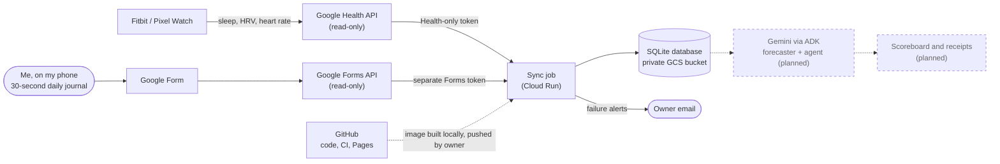
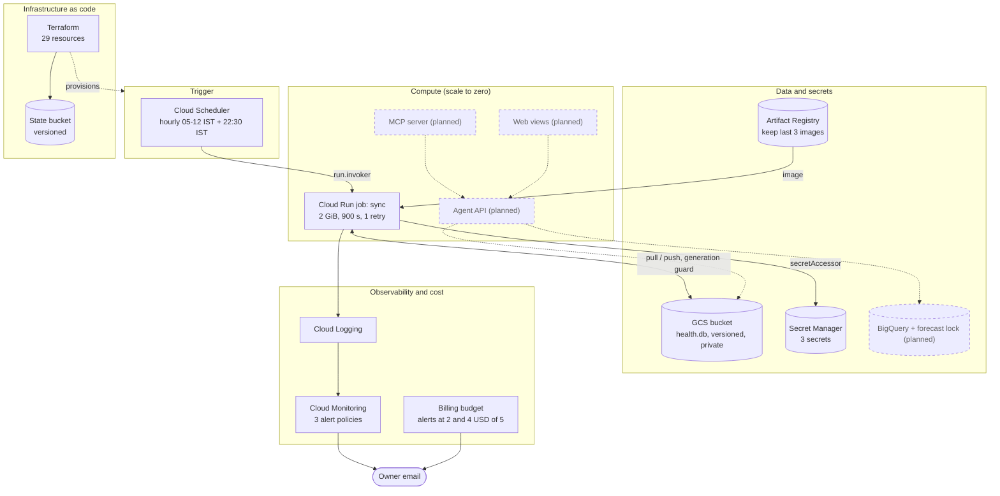
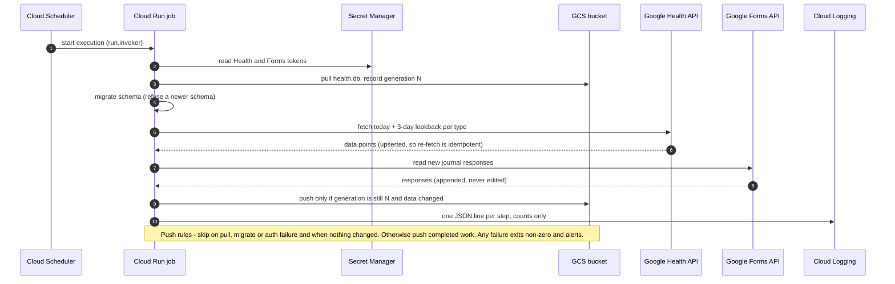
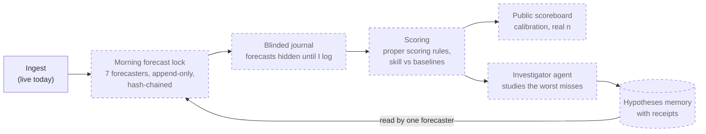

# Calibrated Health Agent

**A personal health agent that keeps score: it forecasts, shows its work, and publishes where it loses.**

[](https://github.com/kb2326/calibrated-health-agent/actions/workflows/ci.yml)


## What it is

Every morning this agent predicts how I will feel that day (mood, energy, soreness) from my
wearable data, then grades itself against my own journal and against dumb baselines such as
"same as yesterday". Every number it states comes from executed code with a re-runnable
receipt, not from an LLM's memory.

**Today (Phase 1)** the data foundation is live on Google Cloud: a scale-to-zero job syncs my
Google Health API data and my daily journal into a versioned database for about $0.03 a month.
The forecasting, agent and web layers are **designed but not built yet**; this README marks
every planned component as such.

## Why it matters

- **Computed, not narrated.** In Google's PHIA study (*Nature Communications*, 2026) a plain LLM
  answered personal-health data questions correctly about 22% of the time; an agent that writes
  and runs code reached 84%. This agent computes, and shows the code.
- **It keeps score.** Health coaches make predictions about you but never publish a per-person
  track record. Here, forecasts are locked before the outcome exists and scored against
  baselines with proper scoring rules, even when the baseline wins.
- **An honest multi-agent test.** Single agent and orchestrator-with-specialists face the same
  evals; the better one is the default. Multi-agent is treated as a hypothesis, not a feature.

## Status

| Phase | What | State |
|---|---|---|
| 0 | Research, live API verification, design | Done |
| 1 | Foundation: ingestion, journal capture, scale-to-zero cloud sync, Terraform, CI | **Done and live** |
| 2 | Honest statistics + forecast ledger (7 forecasters, investigator loop) | Planned |
| 3 | Agent core: code receipts, guarded tools, memory | Planned |
| 4 | Evals, red-team, CI gate, tracing | Planned |
| 5 | Read-only MCP server | Planned |
| 6 | GCP expansion as code (Workflows, IAP services, forecast lock) | Planned |
| 7 | Web views (forecast ledger, receipts) | Planned |
| 8 | Publish: scorecard, write-ups, demo | Planned |

Nothing in phases 2-8 exists in the code yet. Phase 1 has 222 passing tests and CI on every push.

## System context

Who and what talks to whom. Dashed items are planned.



## Cloud architecture

What is deployed in project `artful-timing-506108-n8` (us-central1), plus the planned additions.



## How a sync run works



## Target system design (Phases 2-4, not built)

The daily keep-score loop the foundation exists to feed.



The seven forecasters: climatology, persistence, seasonal-naive, a statistical model,
TimesFM, a Gemini agent, and the same Gemini agent reading its investigator's notes. The open
question the scoreboard answers: does self-reflection make an agent better at predicting
one human? Details in the [architecture](docs/architecture.md).

## Key engineering decisions

| Decision | Why |
|---|---|
| One SQLite file in a private versioned bucket, not a database server | Cheapest durable store for one small, single-writer dataset; versioning gives restore for free. Upgrade path: BigQuery or Cloud SQL. |
| Optimistic concurrency (generation-guarded push) | Two overlapping runs cannot overwrite each other; the loser fails loudly and the next run re-syncs. |
| Scale-to-zero Cloud Run job, not a service | Runs to completion, bills only while running, exposes no endpoint. |
| Append-only journal with one writer (the Google Form) | Forecasts are only trustworthy if outcomes cannot be edited after the fact. |
| Two OAuth tokens (Health and Forms) | Real lesson: the Google Health API rejects any token that also carries non-Health scopes. |
| Idempotent upserts with a 3-day lookback | Late watch uploads are picked up automatically; retries are safe. |
| Civil-day rule in the owner's timezone (Asia/Kolkata) | Daily values must align with the day I actually lived, not UTC. |
| Everything in Terraform, state in a versioned bucket | Reproducible, reviewable, recoverable. |
| Synthetic data in tests and CI | No real health data in the repo or in CI; a fresh clone passes tests. |

## Security and privacy

- **Real data never leaves my cloud project.** Public material will be synthetic or aggregate.
- **Read-only toward the source:** read-only OAuth scopes, and the API client implements no write methods.
- **Least privilege:** the job's identity can use one bucket and three secrets; the scheduler's
  identity can only invoke the job. No public endpoints, no load balancer, public access prevention on the bucket.
- **Secrets stay out of the image, env vars and Terraform state** (Terraform creates empty containers only).
- **Logs carry counts only**, never health values or journal answers.

## Reliability

- A crashed run leaves the old good file untouched until the final push; Cloud Run retries once.
- Overlapping runs are rejected by the generation precondition.
- Bucket versions are kept 14 days for rollback; the Terraform state bucket is versioned.
- Three email alert policies: job ERROR logs, scheduler ERROR logs, failed task attempts. The alert path was tested with a deliberately wrong secret name.
- An older image refuses to write a newer-schema database.

## Cost

| Item | Monthly |
|---|---|
| Cloud Run job, Scheduler (2 jobs), Secret Manager, GCS, monitoring | $0 (free tiers) |
| Artifact Registry (3 images) | about $0.03 |
| **Total** | **about $0.03** |

A $5 budget alerts at $2 and $4. Alerts only notify, so the real guard is the design: nothing scales up on its own.

## Tech stack

| Layer | In use (Phase 1) | Planned |
|---|---|---|
| Language and tooling | Python 3.13, uv workspace, ruff, pyright, pytest, pre-commit | |
| Data | Google Health API, Google Forms API, SQLite, pandas | DuckDB, Parquet, BigQuery |
| Cloud | Cloud Run jobs, Cloud Scheduler, GCS, Secret Manager, Artifact Registry, Logging and Monitoring | Workflows, IAP services, Model Armor |
| Infrastructure | Terraform, Docker, GitHub Actions (lint, types, tests, `terraform validate`) | Keyless deploys with Workload Identity Federation |
| Agents | Google ADK scaffold in `packages/health_agents` | Gemini forecasters, investigator, code sandbox with receipts |
| Protocols and web | | MCP server, Next.js with AG-UI |
| Evals | One starter evalset in `evals/` | ~200-case suite, calibrated judge, red-team, CI gate |

## Repository layout

```text
packages/
  health_core/     settings and shared config
  health_data/     Health API client, auth, reconcile, SQLite store, journal import, GCS sync (cha-data CLI)
  health_agents/   ADK agent and tools (early scaffold)
apps/jobs/         Cloud Run sync job and Dockerfile
infra/             Terraform for the whole cloud slice, plus runbook (infra/README.md)
config/            tracked-types configuration
evals/             starter evalset
tests/             222 tests on synthetic fixtures
docs/              architecture, cloud design, spec, plan, research
.github/workflows/ CI: lint, types, tests, terraform validate
```

## Quickstart

```bash
uv sync --all-packages     # install the workspace (Python 3.13)
uv run pytest -q           # 222 tests on synthetic fixtures; no real data or credentials needed
uv run cha-data --help     # the data CLI
```

Owner-only commands (need my own Google account and GCP project; not needed for the tests):

```bash
uv run cha-data auth login          # Health token (read-only Health scopes only)
uv run cha-data auth login-forms    # separate Forms token for the journal
uv run cha-data auth push-secret    # upload tokens to Secret Manager
export CHA_DB_BUCKET=<bucket>       # GCS is the source of truth for write commands
uv run cha-data db pull             # fetch the database (refuses to overwrite unpushed local changes)
uv run cha-data sync                # sync every tracked type
uv run cha-data journal import      # import Form responses
uv run cha-data backfill --since <YYYY-MM-DD>
uv run cha-data db repair           # re-fetch history under the civil-day rule
```

`cha-data --local-only <command>` writes a scratch copy that is never pushed. Cloud runbook:
[infra/README.md](infra/README.md).

## Documentation

| Read | For |
|---|---|
| [docs/architecture.md](docs/architecture.md) | The full system design, end to end |
| [docs/cloud-design.md](docs/cloud-design.md) | The live cloud design: components, security, reliability, cost |
| [Spec](docs/superpowers/specs/2026-10-20-calibrated-health-agent-design.md) | Vision, goals, non-goals, phases |
| [Phase 1 plan](docs/superpowers/plans/2026-10-20-phase-1-foundation.md) | The executable task list |
| [Research](docs/research/00-synthesis.md) | The research behind each decision, with sources |

## Roadmap

2. **Stats + ledger:** robust baselines, seven forecasters, locked and hash-chained forecasts, investigator loop, public scoreboard.
3. **Agent core:** ADK workflow, single vs multi-agent topologies, sandboxed code with receipts, memory.
4. **Evals:** ~200 cases, calibrated judge, red-team, CI gate, OpenTelemetry tracing.
5. **MCP server:** read-only tools callable from Claude Desktop.
6. **GCP as code:** Workflows, IAP-protected services, BigQuery and the forecast lock, keyless CI deploys.
7. **Web:** forecast ledger and receipts views.
8. **Publish:** scorecard, write-ups and demo.

## Disclaimer

Not medical advice and not a medical device. This project describes one person's data and
does not diagnose. Built with AI assistance; the agent's outputs can be wrong, which is why it keeps score.

## License

Code: Apache-2.0 (see [LICENSE](LICENSE)). A synthetic dataset, when published: CC-BY-4.0.
