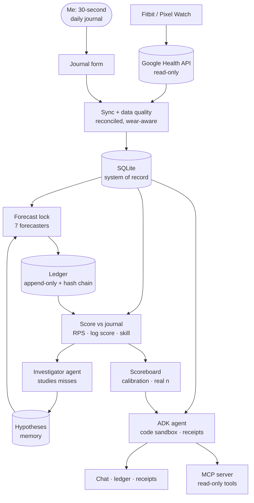
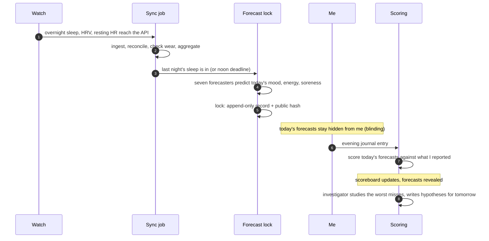
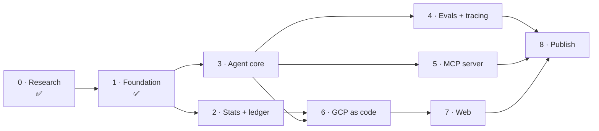
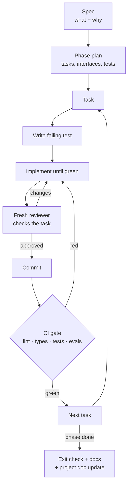

# Calibrated Health Agent

**A personal health agent that keeps score.** It forecasts how I'll feel tomorrow, grades
itself against simple baselines on my real wearable data, shows a code receipt for every
number, and publishes its evals — including where it loses.


> Not medical advice and not a medical device. This project describes one person's data;
> it does not diagnose. Built with AI assistance; the agent's outputs can be wrong — which
> is exactly why it keeps score.

---

## Why this exists

- **Plain LLMs are bad at personal health numbers.** In Google's PHIA study
  (*Nature Communications*, 2026) an LLM answered personal-health data questions correctly
  ~22% of the time; an agent that writes and runs code reached 84%. So this agent
  **computes** — every number comes from executed code, with a receipt you can re-run.
- **Nobody publishes a track record.** Health coaches and papers make predictions about
  you, but none shows its own per-person forecasts scored against a naive baseline. This
  project does, daily, on real data — and publishes the scoreboard even when the baseline wins.
- **Multi-agent is a hypothesis, not a feature.** The agent runs as a single agent and as
  an orchestrator with specialists; both face the same evals, and the winner is the default.

## Status

| Phase | What | State |
|---|---|---|
| 0 | Research, live API verification, design | ✅ done |
| 1 | Foundation: repo, pure + complete ingestion, journal capture, free-tier GCP sync | ✅ done ([cloud design](docs/cloud-design.md)) |
| 2 | Honest statistics + forecast ledger | planned |
| 3 | Agent core: code receipts, guarded tools, memory | planned |
| 4 | Evals, red-team, CI gate, tracing | planned |
| 5 | MCP server | planned |
| 6 | Full GCP deployment as code (scale-to-zero) | planned |
| 7 | Web experience (Next.js + AG-UI) | planned |
| 8 | Publish: README scorecard, Medium, LinkedIn, video | planned |

---

## How it works



### A day in the life



### The agent that learns from its misses

Every night after scoring, an **investigator agent** looks at the forecasts that missed
worst, plans an inquiry, runs code over my data and journal, and writes hypotheses — each
with receipts and evidence counts — into memory. A second Gemini forecaster reads those
notes before betting. The scoreboard compares the two: **does the agent's self-reflection
actually make it better at predicting one human?**

### The forecast ledger — the centrepiece

Seven forecasters compete on one scoreboard, each predicting a full probability
distribution over 1–10 for mood, energy and soreness:

| Forecaster | What it is |
|---|---|
| Climatology | My historical distribution — the outside view |
| Persistence | "Same as yesterday" |
| Seasonal-naive | Same weekday last week |
| Statistical model | Wearable features → ordinal forecast, incl. an open readiness score (HRV, resting HR, sleep vs my baseline) |
| TimesFM | Google's time-series foundation model via BigQuery `AI.FORECAST` |
| Gemini agent | The LLM, given exactly the same inputs |
| Gemini agent + its own notes | The same LLM, also reading hypotheses its investigator wrote about past misses |

Scored with proper scoring rules (ranked probability score, log score), skill against
climatology and persistence, and calibration plots. The analysis plan is pre-registered
(primary endpoint: energy, skill vs persistence). Forecasts are locked before the outcome
exists; forecasts and outcomes are hash-chained to a public log
(`kb2326/cha-ledger-log`), and a public scoreboard on GitHub Pages updates daily. Only
live-locked forecasts count.

Full design: **[docs/architecture.md](docs/architecture.md)** · requirements:
**[the spec](docs/superpowers/specs/2026-10-20-calibrated-health-agent-design.md)**.

---

## The plan



| # | Phase | Delivers | Done when |
|---|---|---|---|
| 1 | Foundation | uv monorepo · reconciled sync with extra data types and scopes · full backfill · journal via Google Form · ADK 2.12 with explicit delegation · Terraform free-tier slice (bucket, secrets, Cloud Run job, Scheduler, budget, three alert policies) | I journal from my phone; the cloud sync runs daily without my laptop; a fresh clone passes tests |
| 2 | Stats + ledger | Wear rules · robust baselines · corrected associations (detrended, CIs, FDR) · six forecasters · pre-registered analysis plan · event-triggered lock · blinding · hash chain to a public log · **public scoreboard on GitHub Pages** | Locked, hash-chained forecasts every day; scoreboard live and updating |
| 3 | Agent core | ADK graph workflow · single vs multi topologies · sandboxed code + receipts · hardened `run_sql` · untrusted-text wrapping · memory · **investigator loop + "with own notes" forecaster** | Every numeric answer has a re-runnable receipt; the investigator writes hypotheses nightly |
| 4 | Evals + tracing | ~200 cases across core, ablation, medical boundary, security, multi-turn · calibrated judge · CI gate · OpenTelemetry | A deliberately regressed prompt fails the gate |
| 5 | Protocols | Read-only MCP server | Claude Desktop calls a tool from a copy-paste config |
| 6 | GCP as code | All jobs on Workflows + Scheduler · IAP owner services at min-instances 0 · synthetic twin · keyless CI deploys · destroy/redeploy drill | Owner mode works behind IAP; a month costs under $5 |
| 7 | Web | Next.js 16 + AG-UI, two views: the forecast ledger and receipts | I can ask a question and open its receipt |
| 8 | Publish | README scorecard · ADRs · Medium article · LinkedIn post · motion video | Clone-and-follow passes on a clean machine |

Each phase gets its own detailed plan when it starts: [Phase 1 plan](docs/superpowers/plans/2026-10-20-phase-1-foundation.md).

## How the work is executed



Rules: test-first, small commits, a fresh review per task, nothing merges red, and every
cost-bearing or outward-facing step (Terraform apply, publishing) waits for explicit approval.

---

## Stack

| Layer | Choice |
|---|---|
| Agents | Google ADK 2.12 (graph workflow, explicit delegation, human approval) · Gemini 3.5 Flash-Lite by default |
| Computation | Sandboxed Python/pandas executor · receipts for every number |
| Data | Google Health API (read-only, reconciled) · SQLite · DuckDB · Parquet · pandera |
| Forecasting | Proper scoring rules · baselines · statistical model · TimesFM via BigQuery |
| Evals | ADK eval via pytest · binary rubrics · calibrated judge · Wilson CIs + McNemar · promptfoo red-team |
| Observability | OpenTelemetry → Phoenix (local) / Cloud Trace |
| Protocols | MCP (spec 2026-07-28) · AG-UI 1.0 |
| Cloud | Cloud Run jobs + services (scale to zero) · Workflows · Scheduler · GCS · BigQuery · Secret Manager · IAP · Model Armor |
| Delivery | Terraform · GitHub Actions with Workload Identity Federation · Docker · uv · ruff · pyright |
| Web | Next.js 16 · AG-UI |

Deliberately not used — LangGraph rewrite, fine-tuning, Kubernetes, Temporal, vector
database servers — with reasons in the [architecture](docs/architecture.md).

## Evidence this repo will publish

Nothing below is measured yet; the table fills in as phases land.

| Evidence | Phase |
|---|---|
| Forecast scoreboard with skill vs baselines, calibration, real n — public on GitHub Pages | 2 → ongoing |
| PHIA-style ablation on my own data: no tools / tools / code / single vs multi-agent, with 95% intervals | 4 |
| Judge calibration (true/false positive rates vs my labels) | 4 |
| Red-team attack-success before/after, mapped to OWASP Agentic IDs | 4 |
| Cost and latency per answer | 4 |
| One trace-based failure retro | 4 |

## Privacy, safety and cost

- **Real data never goes public.** It lives in my GCP project behind IAP or on my machine.
  Public material is synthetic (a statistical twin of my data) or aggregate (skill scores,
  n, reliability plots).
- **Read-only by construction**: read-only OAuth scopes, a 12-method allowlist in the API
  client, read-only SQLite for the agent, no network in the code sandbox.
- **Wellness only**: no diagnosis, no disease names, no clinical instructions — enforced
  by an eval suite.
- **Under $5/month**: free tiers, scale-to-zero, Flash-Lite, budget alerts at $2/$4, quota
  limits. Breakdown in the [architecture](docs/architecture.md#12a-cost-architecture-budget-under-5month).

## Develop

```bash
uv sync --all-packages          # install the workspace
uv run pytest -q                # tests run on synthetic fixtures; no real data or config needed
```

Owner-only commands (need my own Google account and GCP project; not required to run the tests):

```bash
uv run cha-data auth login          # Health consent (read-only Health scopes only)
uv run cha-data auth login-forms    # separate Forms token for the journal (Health rejects mixed scopes)
CHA_TOKEN_SECRET=oauth-token CHA_CLIENT_SECRET_SECRET=oauth-client CHA_FORMS_TOKEN_SECRET=oauth-forms-token uv run cha-data auth push-secret   # tokens -> Secret Manager
export CHA_DB_BUCKET=<bucket>       # GCS is the source of truth: every write command needs it
uv run cha-data db pull             # fetch the database (refuses to overwrite unpushed local changes; --force to discard them)
uv run cha-data backfill --since <YYYY-MM-DD>   # write commands check freshness first and push after
uv run cha-data sync
uv run cha-data journal import
uv run cha-data db repair           # re-fetch history under the owner-zone civil-day rule
uv run cha-data probe               # what each readable type returns
uv run cha-data parity              # rollup vs reconcile agreement
```

Without `CHA_DB_BUCKET`, write commands refuse to run in real mode. `cha-data --local-only <command>`
writes a local scratch copy that is never pushed (and that a later `db pull` will not silently
overwrite). The journal has one writer: the Google Form, read by `journal import`.

Cloud runbook: [infra/README.md](infra/README.md).

## Docs

| Read | For |
|---|---|
| [docs/architecture.md](docs/architecture.md) | How it works end to end, with diagrams |
| [docs/cloud-design.md](docs/cloud-design.md) | The Phase 1 cloud design: components, security, reliability, cost |
| [Spec](docs/superpowers/specs/2026-10-20-calibrated-health-agent-design.md) | Goals, non-goals, decisions and why |
| [Phase 1 plan](docs/superpowers/plans/2026-10-20-phase-1-foundation.md) | The executable task list |
| [docs/research/](docs/research/) | The research behind every decision, with sources |

## Standing on

Google Research's PHIA and Personal Health Agent work · Anthropic's *Building effective
agents* · Hamel Husain & Shreya Shankar on evals · Gneiting & Raftery on proper scoring
rules · Hyndman & Athanasopoulos, *Forecasting: Principles and Practice* · the AHRQ
N-of-1 trials guide · Quantified Self · Simon Willison's lethal trifecta.
Full list with links: [docs/research/07-pioneers-and-references.md](docs/research/07-pioneers-and-references.md).

## License

Code: Apache-2.0. Synthetic dataset (when published): CC-BY-4.0.
