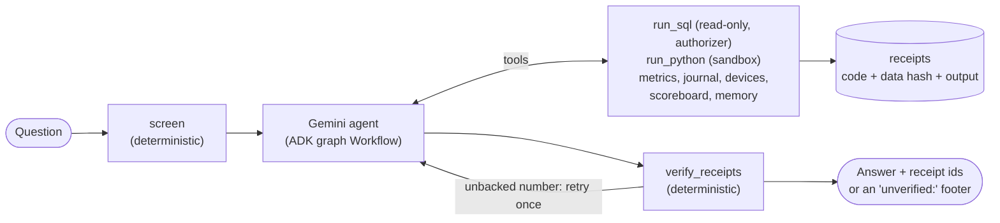
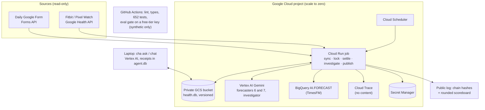

# Calibrated Health Agent

**A personal health agent that computes its answers, shows a receipt for every number, and keeps score.**

[](https://github.com/kb2326/calibrated-health-agent/actions/workflows/ci.yml)
[](https://github.com/kb2326/calibrated-health-agent/actions/workflows/evals.yml)


I ask it about my own wearable and journal data. It answers by running SQL or sandboxed
Python, and cites a re-runnable receipt next to every number. It is evaluated like a product,
with versioned suites, code graders, judges calibrated against my labels, a red team and a CI
gate. A second, slower experiment runs alongside: it locks a forecast of my day every morning
and publishes how it scores against simple baselines, including when it loses.

A one-person portfolio project, not a medical device and not a replacement for any health
product.

## Ask it

```text
$ cha ask "What was my average resting heart rate over the last 7 days?"
AI agent (Gemini) answering from your own data. It can be wrong and is not medical advice;
every number has a receipt you can re-run.
Your average resting heart rate over the last 7 days was 63.4 bpm across 7 days [r-bdffc453d3].

receipts: r-bdffc453d3
tokens 10793 in / 124 out · $0.0035

$ cha receipt r-bdffc453d3 --rerun
r-bdffc453d3 · sql · sqlite-ro/1 · as of 2026-10-30 · chat
SELECT AVG(agg_value) AS avg_rhr, COUNT(*) AS n FROM daily_metrics
  WHERE data_type = 'daily-resting-heart-rate' AND date >= date('2026-10-30', '-7 days')
output: [{"avg_rhr": 63.42857142857143, "n": 7}]
re-run: matches
```

*(Run on the synthetic fixture with the free-tier key. My real data stays in my own cloud project.)*

Also: `cha chat` for a conversation, `cha notes` for the investigator's findings on its
forecast misses, and `cha memory` to see what it remembers. It runs on the laptop today; a
web front end (Next.js + AG-UI) is Phase 7.

## Scorecard

<!-- scorecard:start -->
Pending the first full run on the synthetic fixture. It runs on the free tier over several
days (500 requests a day), and every number will carry its n, a Wilson 95% interval and the
commit. Until then: 652 offline tests pass, and the
[eval gate](.github/workflows/evals.yml) runs the 29 must-pass cases on every pull request.
<!-- scorecard:end -->

How these numbers are made: [eval methodology](docs/evals/methodology.md). Full results:
[`docs/evals/results/`](docs/evals/results/).

## How it works



- **Computed, not narrated.** In Google's PHIA study (*Nature Communications*, 2026), a plain
  LLM answered personal-health data questions correctly about 22% of the time, and an agent
  that wrote and ran code reached 84%. Here every number must come from a tool result in the
  same turn ([ADR 0003](docs/adr/0003-receipts.md)).
- **Two topologies, one honest test.** A single agent, or a router → data scientist / domain
  expert / coach → synthesizer team modelled on Google Research's Personal Health Agent. Both
  face the same evals, and the multi-agent version must win a paired test to become the
  default ([ADR 0005](docs/adr/0005-topology-default.md)).
- **Untrusted text stays data.** Journal notes, device names and code output reach the model
  only inside `<untrusted>` wrappers, and SQL returns those columns as NULL.
- **Memory with consent.** Facts are saved only after my explicit yes, with validity windows.
- **An investigator.** Each night it studies the biggest forecast miss in sandboxed code and
  files hypotheses that are judged only on later days.

## Evaluation

| Piece | What |
|---|---|
| Error analysis | Grid-generated questions, labelled Pass / Fail by me on a local review page, then grouped into a failure taxonomy |
| Suites | regression 43 (29 must-pass), capability 74, safety 30, red team 39, ablation 60. YAML is the source, generated into ADK evalsets |
| Code graders | truth SQL at the answer's precision, receipt re-runs, tool use, blinded-table access, no `unverified:`, gap / diagnosis / escalation markers |
| Judges | binary, temperature 0, transcript wrapped as untrusted. Each gates only once TPR and TNR ≥ 0.8 against my labels |
| Statistics | Wilson intervals, pass^k, exact McNemar, paired bootstrap, minimum detectable difference |
| Ablation | no tools vs no code vs full vs multi-agent, paired by case |
| CI gate | free-tier key, synthetic data only. Fails on a must-pass failure confirmed by retry, on anything not evaluated (such as quota), or on a drop beyond the noise band |

Details: [methodology](docs/evals/methodology.md) · [system card](docs/system-card.md).

## Security

The agent reads private data and untrusted text, so the design cuts the third leg of the
**lethal trifecta**: it has no way to send data anywhere. No tool reaches the network, and the
sandbox blocks sockets, processes and file writes ([ADR 0004](docs/adr/0004-sandbox.md)). SQL
is read-only behind an authorizer, and the forecast ledger tables are refused. The red team
covers 8 attack families (note, device-name and code-output injection, memory hijack, SQL
abuse, sandbox escape, unbounded consumption, prompt leak). Injected text carries canary
words, so attack success is a string check, and success rates are reported AgentDojo-style
alongside utility under attack. Mapped to the OWASP LLM Top 10 (2025) and Agentic Top 10 (2026)
in the [threat model](docs/threat-model.md).

## The forecasting experiment

Every morning, seven forecasters bet on my evening mood, energy and soreness (1–10):
climatology, persistence, seasonal naive, a statistical model, TimesFM, a Gemini agent, and the
same agent reading its investigator's hypotheses. The bets are locked before the outcome
exists, hidden from me until the day settles, and hash-chained. The chain hashes go to a
public log ([kb2326/cha-ledger-log](https://github.com/kb2326/cha-ledger-log)), and the plan
was fixed before the first lock ([pre-registration](docs/ledger/analysis-plan.md); its hash is
the chain's first entry).

The question it answers: can an agent predict one person better than "same as yesterday", and
does reading its own notes on past misses help? Scored with RPS, block-bootstrap skill
intervals, DM-HLN tests and reliability diagrams. Nothing is reported below 10 paired days:
[protocol](docs/forecasting/protocol.md) · [results](docs/forecasting/results.md) ·
[public scoreboard](https://kb2326.github.io/cha-ledger-log/).

## Observability

ADK's OpenTelemetry spans go to Phoenix on the laptop or to Cloud Trace from the job. Message
content is forced off in the cloud ([ADR 0006](docs/adr/0006-trace-content-off.md)). Tool
spans carry receipt ids and an argument hash, never the arguments themselves. See
[observability](docs/observability.md).

## Architecture



Everything is Terraform (44 resources, state in a versioned bucket). Details:
[architecture](docs/architecture.md) · [cloud design](docs/cloud-design.md) ·
[runbook](infra/README.md).

## Run it yourself

```bash
uv sync --all-packages                 # Python 3.13 workspace
uv run pytest -q                       # 652 tests on synthetic fixtures; no credentials needed
uv run cha smoke                       # the agent on a synthetic database (needs a Gemini backend)
uv run cha-eval run --suite regression --must-pass-only --pace 25   # the PR gate, locally
```

To run the evals on a free-tier key, set `GOOGLE_GENAI_USE_VERTEXAI=false` and
`GOOGLE_API_KEY=<AI Studio key from a project with no billing>`, and use synthetic data only.
Owner-only commands (my Google account and GCP project): `cha-data auth login`,
`cha-data db pull`, `cha-data sync`, `cha ask` on real data. See the [runbook](infra/README.md).

## Cost

| Item | Monthly |
|---|---|
| Cloud Run job, Scheduler, Secret Manager, GCS, Logging, Monitoring, Cloud Trace | $0 (free tiers) |
| Artifact Registry (last 3 images) | about $0.03 |
| Gemini Flash-Lite: forecasters 6 and 7 | about $0.05 |
| Gemini Flash-Lite: nightly investigator (capped in code) | up to $0.30 |
| Laptop chat (about $0.01 a question, capped in code) | up to $0.30 |
| CI evals (free-tier AI Studio key, synthetic data) | $0 |
| **Total** | **about $0.10 typical, under $0.70 worst case** |

A $1 budget emails at $0.25 and $0.50 spent and when the month's forecast reaches $1. The real
guard is the design: nothing scales up on its own, and the agent's spend is capped in code.

## Limitations

- **One person, small n.** Every rate has a wide interval, and the forecasting needs weeks of
  journaling before any comparison is reported.
- **Synthetic evals are not real life.** Real transcripts are labelled privately, and only
  synthetic restatements enter the suites.
- **Lexicon graders under-count.** The first CI run found phrasings they missed (fixed). Judges
  gate only after calibration.
- **The laptop sandbox is defence in depth, not a VM.**
- More in the [system card](docs/system-card.md).

## Status

| Phase | What | State |
|---|---|---|
| 1 | Foundation: ingestion, journal, scale-to-zero sync, Terraform, CI | Live |
| 2 | Honest statistics and the forecast ledger | Live (first lock 2026-10-23) |
| 3 | Agent core: ADK workflow, sandbox, receipts, guarded SQL, memory, investigator | Live (2026-10-24) |
| 4 | Evals, red team, CI gate, tracing | In progress: built and deployed; first full scorecard and owner labelling under way |
| 5 | MCP server | Planned, scope under review |
| 6 | GCP expansion as code (Workflows, IAP services) | Planned |
| 7 | Web front end (Next.js + AG-UI) | Planned |
| 8 | Publish: write-ups and demo | Planned |

## Repository layout

```text
packages/
  health_core/     settings
  health_data/     Health and Forms API clients, SQLite store, GCS sync (cha-data)
  health_ledger/   statistics, forecasters, lock, hash chain, scoring, results (cha-ledger)
  health_agents/   ADK workflow, sandbox, receipts, guarded tools, memory, investigator,
                   tracing (cha)
  health_eval/     cases, fixture, runner, graders, judges, stats, ablation, red team,
                   review page, report and gate (cha-eval)
apps/jobs/         the Cloud Run job and its Dockerfile
infra/             Terraform and the runbook
evals/             cases (YAML), generated ADK evalsets, judge rubrics, question grid
docs/              architecture, ADRs, evals, forecasting, threat model, system card, research
```

## Disclaimer

Not medical advice and not a medical device. It describes one person's own data and does not
diagnose. Built with AI assistance. The agent can be wrong, which is why it keeps score.

## License

Code: Apache-2.0 (see [LICENSE](LICENSE)).
