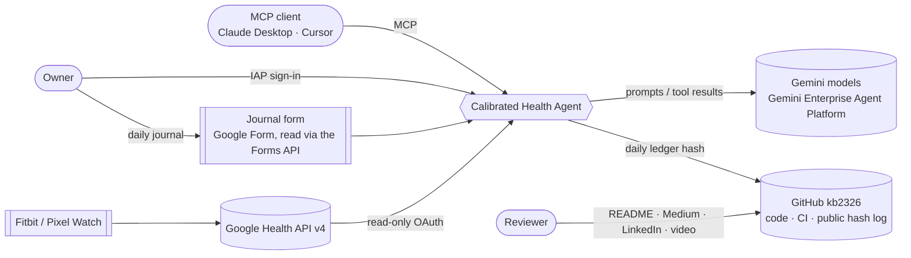
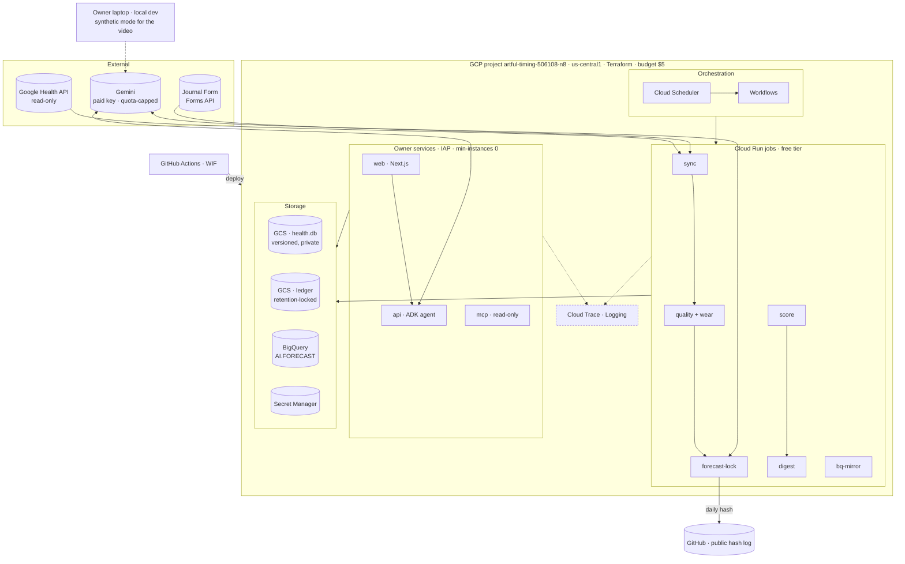
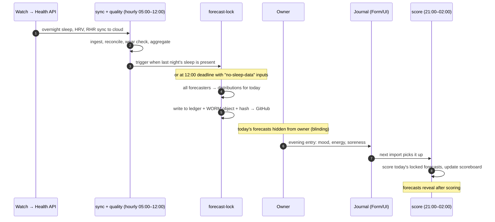
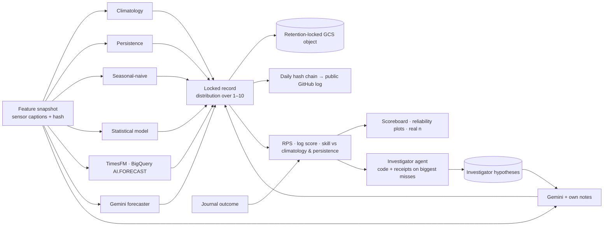
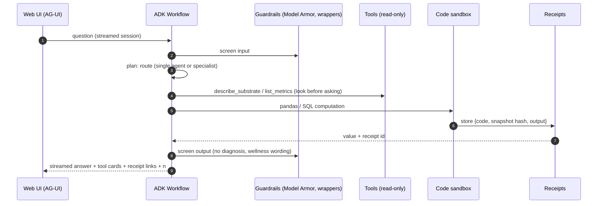
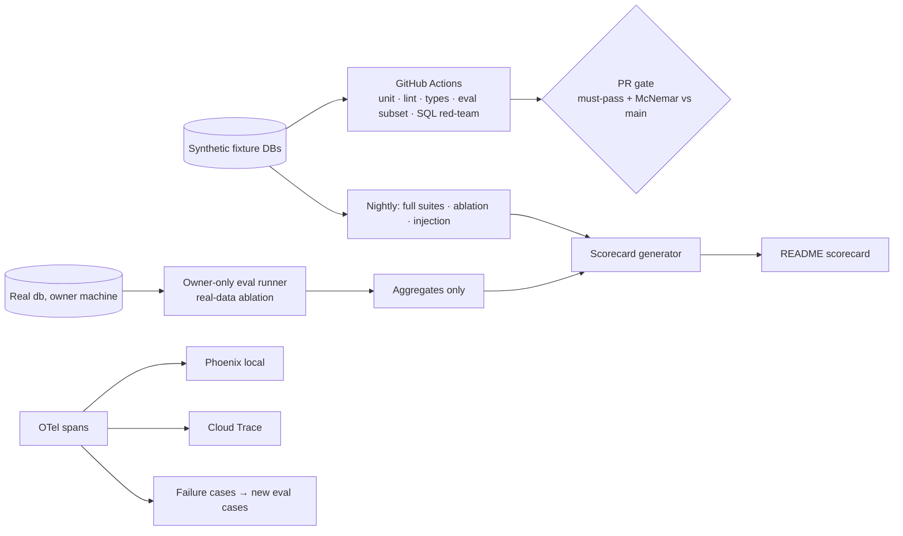

# Calibrated Health Agent — Architecture

**Status:** Approved by owner 2026-10-20 · **Date:** 2026-10-20
**Companion to:** `docs/superpowers/specs/2026-10-20-calibrated-health-agent-design.md` (the *what* and
*why*). This document is the *how*, end to end, from vision down to deployment.
Diagrams are Mermaid and render on GitHub.

---

## 1. From vision to architecture

> A personal health agent that **keeps score**: it forecasts how you'll feel tomorrow,
> grades itself against simple baselines on your real data, shows a code receipt for
> every number, and publishes its evals — including where it loses.

Each pillar of the vision becomes one architectural commitment:

| Vision pillar | Architectural commitment | Where |
|---|---|---|
| Real data | Read-only ingestion from the Google Health API into a single system of record; nothing invented, every value traceable to an API data point | §4, §5 |
| Forecasts how you'll feel | A scheduled forecast-lock job writes probabilistic forecasts to an append-only, tamper-evident ledger before the outcome exists | §6 |
| Grades itself against baselines | Several forecasters (baselines, statistical, TimesFM, Gemini) compete on one scoreboard with proper scoring rules | §6 |
| A receipt for every number | Agent answers come from executed code/SQL; each result is stored as a re-runnable receipt | §7 |
| Publishes its evals | Eval suites gate CI; scorecards are generated artifacts, never hand-written | §9 |
| Including where it loses | Single- vs multi-agent and LLM vs baseline comparisons are first-class outputs | §6, §9 |
| Your data, safely | Real data only in owner-only surfaces (IAP or local); public material is synthetic or aggregate; least privilege; no health data in traces | §10, §11 |

### Design principles

1. **Read-only toward the source, append-only toward evidence.** The API is never written; ledger records are never edited.
2. **Compute, don't narrate.** Numbers come from code; models explain them.
3. **Deterministic skeleton, LLM steps where they earn it.** Pipelines and the forecast lock are plain code; LLMs sit inside bounded steps.
4. **Baselines everywhere.** No metric ships without its naive comparator and n.
5. **Privacy by topology, not by promise.** Real data is physically absent from anything public.
6. **Small and boring infrastructure.** Scale-to-zero managed services, one SQLite file, Terraform.
7. **Near-zero cost by construction.** Free tiers, scale-to-zero, Flash-Lite, hard budget guards (§12a).

---

## 2. System context



External dependencies: the Google Health API (data), Gemini (reasoning), Google Forms API
(journal until the owner UI exists), GitHub (code, CI, public hash log).

---

## 3. Containers (deployed shape)



| Container | Runtime | Purpose | Data it may touch |
|---|---|---|---|
| `sync` job | Cloud Run job | Pull API deltas + journal entries; write raw points | real db (rw) |
| `quality` job | Cloud Run job | Wear detection, daily aggregation, pandera checks | real db (rw) |
| `forecast-lock` job | Cloud Run job | Run all forecasters, lock forecasts, write hash | real db (rw), ledger bucket (append), BigQuery (read) |
| `score` job | Cloud Run job | Score matured forecasts against journal | real db (rw) |
| `bq-mirror` job | Cloud Run job | Copy daily tables to BigQuery | real db (r), BigQuery (rw) |
| `digest` job | Cloud Run job | Weekly digest + aggregate scorecard | real db (r) |
| `api` (owner) | Cloud Run service, IAP | ADK agent over real data | real db (r), BigQuery (r) |
| `web` (owner) | Cloud Run service, IAP | UI incl. journal and memory | via api only |
| `mcp` (owner) | Cloud Run service, IAP | Read-only MCP tools | real db (r) |
There is **no public deployment** (owner decision: not worth paying for). Owner services
run with `min-instances=0`, so they cost nothing while idle; jobs stay inside free tiers.
Each service and job runs as its **own service account**. A public synthetic variant is
defined in Terraform as a learning exercise (no IAM path to real data, `DATA_MODE=synthetic`)
and is deployed briefly, if at all, then destroyed.

---

## 4. Google Health API usage — making the most of it, purely

### 4.1 Data purity

- **Raw first.** Every API data point is stored as returned (`raw_json`), with its data
  source (device/platform), before any transformation. Daily values are *derived* and
  always re-computable from raw.
- **Reconciled streams for totals.** Summed types (steps, distance, calories, active
  minutes) are taken from `dataPoints.reconcile` (merges multiple sources into one
  stream) or `dailyRollUp`, so phone + watch never double-count. Today's sync lists raw
  points per source without reconciling — fixed in Phase 1.
- **No measurement mixing.** HRV from different statistics (e.g. RMSSD vs SDNN) or
  devices is never averaged together; source is a column, not a footnote.
- **What the API already processed** (e.g. device-computed HRV, sleep stages, resting HR)
  is labelled as device-derived in receipts.
- **The journal is the only non-API data**, and is labelled as self-report with entry time.

### 4.2 Endpoint map

| Method | Use in this system | Status today |
|---|---|---|
| `dataPoints.list` | Raw samples for point types (HRV, SpO2, sleep sessions, exercise) | used |
| `dataPoints.reconcile` | De-duplicated multi-source stream for summed types | **add** |
| `dataPoints.dailyRollUp` | Civil-day aggregates (≤90 days/call; 14 for HR, calories, active minutes) | used |
| `dataPoints.rollUp` | Physical-interval aggregates (heart rate windows) | used |
| `dataPoints.get` | Receipt drill-down to a single source point | **add** |
| `dataPoints.exportExerciseTcx` | Workout detail (route-free summary only; location not requested) | later, optional |
| `users.getProfile` / `getSettings` | Units, time zone, age/sex for context (needs `profile.readonly`, `settings.readonly`) | **add scopes** |
| `users.pairedDevices.list/get` | Device inventory → wear detection and source labels | **add** |
| `users.getIdentity` | Stable user id for the subscription | add with webhooks |
| `projects.subscribers` + `subscriptions` | Push notifications when new data lands (replaces hourly polling) | Phase 6+ |
| `getIrnProfile`, ECG | Cardiac notifications/ECG — **excluded**: closest to clinical territory | deliberately unused |
| any create/patch/delete/update | — | **unreachable** (client allowlist + read-only scopes) |

### 4.3 Data types

- **Synced today (11):** steps, active-minutes, distance, total-calories, exercise, sleep,
  heart-rate, daily-resting-heart-rate, heart-rate-variability, oxygen-saturation, weight.
- **Add (readable, useful for forecasting):** daily-heart-rate-variability,
  daily-oxygen-saturation, daily-respiratory-rate, respiratory-rate-sleep-summary,
  daily-sleep-temperature-derivations, active-zone-minutes, time-in-heart-rate-zone,
  daily-vo2-max, sedentary-period, floors. Final list after checking what the device emits.
- **Not readable by design of the API:** `moods`, `symptoms` (write-only scopes) — which
  is why the journal is this project's own.
- **Not requested:** location, nutrition (unless the owner logs food), reproductive health.

### 4.4 Limits handled

300 requests/min/user (backoff on 429/504) · 10,000 items/page (25 for sleep and exercise)
· rollup windows split per type · bounded pagination (three exit conditions, one of which
trusts the server) · token refresh with the consent screen **In Production**.

---

## 5. Data model and daily data flow

### 5.1 Storage layers

```
raw_points        API data as returned + source + fetched_at        (append; idempotent upsert)
sync_state        cursor per data type                               (committed with rows)
daily_metrics     derived per day per metric + worn flag + n          (recomputable)
wear_days         per day per metric family: worn / not worn + rule  (recomputable)
journal_submissions  append-only: values · note · submitted_at · source · row_hash · status (ok/late/edited/invalid)
journal_outcome      view: first ok submission per day inside its window
forecasts         forecaster · target · day · distribution · inputs_hash · locked_at (append-only)
scores            forecast_id · RPS · log score · matured_at
receipts          code/SQL · data snapshot hash · output · executor · created_at
memory_facts      typed fact · valid_from · valid_to · approved_at
memory_episodes   text · embedding · day · source
```

SQLite is the system of record, held in GCS as the single source of truth (local writes
pull first). It holds daily values and point/session raw data only, capped at 50 MB;
minute-level reconciled streams are used for parity and wear checks, never stored in it.
DuckDB attaches it for analytics; Parquet exports feed BigQuery and the synthetic-twin builder.

### 5.2 A day in the life (owner time zone)



Rules:
- A forecast for day D may use all data **through the end of the sleep that ended on the
  morning of D**. Lock is **event-triggered** (sleep record present) with a **12:00 local
  deadline**; deadline locks record which inputs were missing.
- A journal entry submitted **before** that day's lock invalidates the day for scoring.
- **Blinding (default):** unmatured forecasts are hidden from every owner-facing surface
  — UI, chat, digest, MCP, memory — until the day is scored. (Owner can opt out; opting out
  is logged and those days are flagged.)

---

## 6. Forecast ledger



- **Targets:** mood, energy, soreness (1–10), each a full probability distribution.
- **Forecasters 1–6 all lock from Phase 2** (TimesFM via BigQuery and Gemini included), so
  no forecaster loses live days.
- **Scoring:** ranked probability score (ordinal), log score, skill scores vs climatology and
  persistence, reliability diagrams, rolling-origin windows.
- **Evidence integrity:** each day's forecasts **and imported outcome** are hashed and
  chained (hash includes the previous day's hash); records go to a **retention-locked**
  bucket and the chain hash (date + hash only) is pushed to the public repo
  `kb2326/cha-ledger-log`, whose first entry is the hash of the pre-registered analysis plan.
  A **GitHub Pages scoreboard** (aggregates and "days locked") is published from it.
- **Primary endpoint:** energy, RPS skill vs persistence, with paired block-bootstrap
  intervals; calibration via PIT or coarse bins.
- **Live vs backtest:** the scoreboard counts **live locked** forecasts only. Rolling-origin
  backtests (useful for forecasters added later) appear in a separate, clearly labelled panel.
- The Gemini forecaster receives exactly the same feature snapshot as the statistical
  models — no extra context — so the comparison is fair.

---

## 7. Agent layer

### 7.1 Request flow (owner asks a question)



### 7.2 Components

| Component | Design |
|---|---|
| Framework | Google ADK 2.12.x pinned; graph `Workflow` with deterministic nodes and LLM nodes |
| Topologies | `single` (one agent, all tools) and `multi` (orchestrator → data scientist · domain expert · coach, explicit `single_turn`/`task` modes). Config switch; both evaluated; winner is default |
| Models | Gemini 3.8 Flash (orchestration), 3.5 Flash-Lite (specialists, batch, forecaster 6), Gemini Embedding 2; IDs in config |
| Inputs | Sensor captions (computed summaries), not raw rows |
| Code execution | Sandboxed Python/pandas (container locally, managed sandbox wrapped as a tool when deployed); no network; time and memory limits |
| `run_sql` | SQLite `mode=ro` + authorizer allowlist + progress-handler timeout + single-statement parse; row cap |
| Untrusted text | Journal notes and source names wrapped and labelled as data before any prompt |
| Memory | Typed facts with validity windows + episode vectors in SQLite, behind ADK's memory interface; saving requires owner confirmation (`require_confirmation`); Memory Bank optional backend |
| Literature RAG | Europe PMC abstracts, hybrid retrieval, citations verified against source; unverifiable claims dropped (later phase) |
| Ledger access | Agent can read matured scores and scoreboard; unmatured forecasts invisible under blinding |
| Investigator | Nightly after scoring: investigates the largest misses with code, writes hypotheses (receipts, n, status) into memory; forecaster 7 reads them; hypotheses re-tested and audited |
| Interfaces | AG-UI (web), MCP (tools) |

---

## 8. Interfaces

| Interface | Protocol | Exposes |
|---|---|---|
| Web ↔ agent | AG-UI 1.0 over SSE (`ag-ui-adk`) | streamed text, tool calls, step timeline, confirmations |
| MCP server | MCP spec 2026-07-28, stdio + Streamable HTTP | read-only tools (metrics, series, scoreboard, receipts) + resources per data type |
| Jobs | Workflows → Cloud Run jobs | sync, quality, lock, score, mirror, digest |
| Journal | Google Form, read directly via the Forms API (now), owner web form (later) | daily entries with timestamps |

---

## 9. Evaluation and observability



- **CI uses synthetic fixtures only**; the **real-data ablation** (no tools / tools / code /
  single vs multi) runs in an owner-only local runner and publishes aggregates only.
- Judge: one binary judge per failure mode, calibrated on owner labels (TPR/TNR reported).
- Stats: Wilson 95% intervals; paired McNemar; cost and latency per run.
- Tracing: OTel GenAI spans (agent, model, tool); deployed spans carry **no message
  content**; token/cost/latency aggregated per turn.

---

## 10. Security architecture

| Threat (lethal-trifecta leg) | Control |
|---|---|
| Private data exposure | Real data only in owner services behind IAP (owner identity only) or on the owner's machine; nothing public has an IAM path to it |
| Untrusted content steering the agent | Stored text wrapped as data; Model Armor; per-agent tool allowlists; red-team suite with poisoned DBs |
| Exfiltration / egress | Tools are read-only; sandbox has no network; MCP server read-only, no token passthrough |
| SQL abuse / DoS | Authorizer allowlist, timeouts, row caps, single statement |
| Secret leakage | Secret Manager; WIF for CI (no keys); secrets never in repo or images |
| Ledger tampering | Append-only forecasts and journal submissions, retention-locked bucket, public hash chain in `kb2326/cha-ledger-log` |
| Silent failure (the old 2-month gap) | Log-based alert on job failure → email; job exits non-zero on any failed step |
| Medical harm | Wellness-only wording, boundary eval suite, disclaimers, AI disclosure |
| Cost runaway | No public endpoint; min-instances 0; Gemini key quotas; Flash-Lite defaults; Cloud Run spend cap; budget alerts at $2/$4 |

---

## 11. Privacy architecture

| Surface | Real data? | What appears |
|---|---|---|
| Owner web/api/mcp (IAP or local) | yes | everything, to the owner only |
| Video (Claude motion) | **no** | synthetic-mode UI; a **simulated** ledger on synthetic journals, labelled as such |
| README / Medium / LinkedIn | aggregates only | skill scores with n and reliability plots; never raw series, raw distributions or day-level values |
| Traces / logs | no content | spans without message bodies |
| GitHub | no | code, synthetic data, public hash chain (hashes reveal nothing) |

**Synthetic twin:** built from real data with seasonal/AR/copula models (wearables *and*
journal, so the simulated ledger in the video is meaningful); published with a fidelity report whose
real-side statistics respect the owner's publishing line; privacy check that no real day is
reproduced.

---

## 12. Environments

| Environment | Where | Data | Purpose |
|---|---|---|---|
| Local dev | Owner's Windows machine (+ containers) | real db copy, fixtures | build, owner-only evals |
| CI | GitHub Actions | synthetic fixtures | tests, eval gate |
| Owner prod | GCP `artful-timing-506108-n8`, `us-central1`, IAP | real | daily jobs, private use |
| Synthetic | local (and optionally a short-lived Cloud Run deploy) | synthetic twin | video, screenshots, learning the public pattern |

## 12a. Cost architecture (budget: under $5/month)

| Item | Free tier used | Expected monthly cost |
|---|---|---|
| Cloud Run jobs (6 short daily/hourly jobs) | 180k vCPU-s, 360k GiB-s | $0 |
| Cloud Run services (owner, min-instances 0) | 2M requests | $0 |
| Cloud Scheduler (≤3 jobs) · Workflows (≤5k steps) | yes | $0 |
| Cloud Storage (db versions, ledger bucket) — US region | 5 GB | $0 |
| BigQuery (mirror + `AI.FORECAST`) | 10 GB storage, 1 TB query | ≈ $0 |
| Secret Manager · Artifact Registry (cleanup policy) · Trace · Logging | yes | $0 |
| Model Armor | 2M tokens | $0 |
| Gemini, real data: daily forecaster + owner chat (Flash-Lite) | — | ≈ $0.10–1 |
| Gemini, synthetic-fixture evals / CI | free-tier key (synthetic data only) | $0 |
| Gemini, rare real-data ablation runs (costed before running) | — | ≈ $1–2 per run |
| **Total target** | | **≈ $1–2, hard ceiling $5** |

Guards: budget alerts at $2 and $4; Cloud Run spend cap; per-day quota on the paid Gemini
key; Flash-Lite by default; no always-on instances; Artifact Registry cleanup policy;
message content off in traces (also keeps span volume small).

---

## 13. Repository layout (target)

```
apps/
  api/        ADK agent service (AG-UI endpoint)
  web/        Next.js 16 app
  jobs/       sync · quality · forecast-lock · score · bq-mirror · digest
  mcp/        read-only MCP server
packages/
  health_core/    settings, models, logging, DATA_MODE
  health_data/    API client (allowlist), storage, wear rules, aggregation
  health_ledger/  forecasters, locking, scoring, hash chain
  health_agents/  workflow, topologies, tools, sandbox, receipts, memory
  health_eval/    suites, judge, stats, scorecard
  health_synth/   synthetic twin + fidelity report
infra/        Terraform (project, IAM, Cloud Run, Workflows, Scheduler, buckets, BigQuery, WIF)
evals/        cases and fixtures
docs/         architecture, ADRs, spec, runbooks
```

---

## 14. Phase-to-architecture map

| Phase | Architecture that becomes real |
|---|---|
| 1 Foundation | Repo + layout; API client with reconcile/profile/devices; **thin GCP slice**: personal project, Secret Manager token, GCS db, Scheduler → one `sync` job; journal Form import |
| 2 Ledger | `quality`, `forecast-lock`, `score` jobs; all six forecasters (incl. BigQuery mirror + TimesFM, Gemini); WORM bucket + hash chain; blinding |
| 3 Agent core | Workflow, both topologies, sandbox, receipts, guarded tools, memory |
| 4 Evals | Fixtures, suites, judge, CI gate, owner-only runner, tracing |
| 5 Protocols | MCP server |
| 6 Deploy | Full Terraform, IAP owner services (scale to zero), all jobs on Workflows, synthetic twin, WIF CD, destroy/redeploy drill, cost report, webhooks |
| 7 Web | AG-UI app with two views: forecast ledger and receipts |
| 8 Publish | README scorecard, ADRs, video, blog |

---

## 15. Decisions

Owner (2026-10-20): GCP project `artful-timing-506108-n8`; spend under $5/month; no paid
public deployment, but learn deployment through this project; publish via LinkedIn, Medium
and a Claude motion video; commits with the personal email; GitHub `kb2326`.

Calls (owner may override): publishing line = skill scores, n, reliability plots; blinding
on; Flash-Lite by default; region `us-central1`; repo private until launch review.

Name (owner, 2026-10-20): **Calibrated Health Agent**, repo `kb2326/calibrated-health-agent`; "keeps score" remains the tagline.
