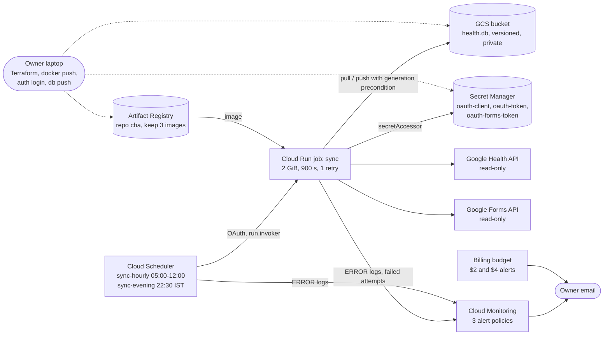

# Cloud design: the daily sync (Phase 1)

**Summary.** Two Cloud Scheduler triggers run one Cloud Run job. The job pulls a SQLite
file from a private bucket, fetches new Google Health data and journal answers, and writes
the file back. No servers stay running, nothing is exposed to the internet, and it costs
about $0.03 a month. Everything is Terraform (29 resources) in project
`artful-timing-506108-n8`, region `us-central1`.

Status: live. The first cloud run completed every step (pull, migrate, sync, journal, push).
This document covers what Phase 1 built; the full system design is in
[architecture.md](architecture.md).

## 1. Architecture

## 2. Components and why

| Component | Role | Why this choice |
|---|---|---|
| Cloud Scheduler (`sync-hourly` `0 5-12 * * *`, `sync-evening` `30 22 * * *`, Asia/Kolkata) | Triggers the job | Managed cron; 2 jobs fit the free allowance. Hourly in the morning catches last night's sleep as soon as the watch uploads it. |
| Cloud Run job `sync` (2 GiB, 900 s, 1 retry) | Runs one batch: pull, migrate, sync, journal, push | A job, not a service: runs to completion, bills only while running, no endpoint to attack. |
| GCS bucket `...-health-db` | Holds `health.db`, the system of record | Cheapest durable store for one small file. Private, public access prevention enforced, versioned; superseded versions are kept 14 days. |
| Secret Manager | `oauth-client`, `oauth-token` (Health), `oauth-forms-token` (Forms) | Tokens never live in the image, env vars or Terraform state (Terraform creates empty containers only). |
| Artifact Registry `cha` | Stores the job image | Keep-3 cleanup policy holds the repo near the free 0.5 GB. |
| Service accounts `sync-job`, `sync-scheduler` | Identities for the job and the trigger | One identity per duty, each with the minimum roles (see section 4). |
| Cloud Monitoring (3 policies) + email channel | Tells the owner when a run fails | Email is enough for one person; no pager needed. |
| Billing budget | Cost guard | Alerts at $2 and $4 of a $5 budget. |
| Terraform + versioned state bucket | Infrastructure as code | Reproducible, reviewable, and recoverable. |

## 3. Data flow of one run

1. Scheduler calls the Cloud Run Admin API as `sync-scheduler`; a new execution starts.
2. **pull**: download `health.db` and record the object's generation number.
3. **migrate**: apply any pending schema migrations (each inside `BEGIN IMMEDIATE`). A
   database with a newer schema than the image knows is refused, never written.
4. **sync**: fetch today plus a 3-day lookback per data type (further back after missed
   runs), with every window and every daily value in the owner's civil day (Asia/Kolkata;
   rule in [architecture.md §5.1a](architecture.md)). Storage is upsert-based, so refetching
   is idempotent and late uploads land.
5. **journal**: read Form responses with the Forms token and append new ones (lateness is
   graded on each response's last submit time).
6. **push**: upload `health.db` only if the bucket generation still equals the one recorded at pull.
7. Each step logs a JSON line with counts only (no health values; a journal failure logs the
   error type and response id only). Any failure logs `ERROR` and exits non-zero.

**Push rules.**

| Outcome of the run | Journal step runs? | Pushed? |
|---|---|---|
| pull or migrate fails | no | no |
| sync fails with an auth error (re-login needed) | yes (reports a broken Forms token too) | no |
| sync raises any other exception | yes | yes: each data type that finished before the exception committed atomically with its cursor |
| sync completes with some failed data types | yes | yes |
| journal step fails after sync completed | (it ran) | yes: the completed sync is never lost |
| nothing changed (no migration, no new or changed rows, no new journal submissions) | yes | no: logged "skipped (no data changed)"; cursors alone are not worth a bucket version, and the next run re-fetches the lookback anyway |

Any failure in the table still exits non-zero and alerts.

## 4. Security model

| Identity | Can do | Cannot do |
|---|---|---|
| `sync-job` | Read and write objects in the data bucket (objectAdmin on that bucket only); read the 3 secrets (secretAccessor per secret) | Touch other buckets, write secrets, change infrastructure |
| `sync-scheduler` | `run.invoker` on the `sync` job only | Read data or secrets |
| Owner (laptop) | Terraform, image push, token upload | n/a (human, local only) |

- **No public endpoints.** There is no service, load balancer or VPC. The bucket enforces
  public access prevention.
- **Secrets handling.** Values are written by `cha-data auth push-secret` from the owner's
  machine; the previous version is kept disabled for rollback and older ones are destroyed. Terraform never sees a token. Logs carry counts only.
- **Read-only toward the source.** OAuth scopes are Health read-only scopes, and the API
  client implements no write methods.
- **Lesson: two tokens.** The Google Health API rejects an access token that also carries
  non-Health scopes ("Request contains disallowed OAuth scope(s)"). So Health and Forms
  use separate tokens, with their own login commands and secrets. Forms scopes are
  `forms.responses.readonly` and `forms.body.readonly`.
- **Consent screen.** It is "In production" (unverified, personal use), so refresh tokens
  do not expire after 7 days as they do in Testing mode. The homepage and privacy policy
  are at https://kb2326.github.io/calibrated-health-agent/.

## 5. Reliability: what happens when something fails

| Failure | What happens | Recovery |
|---|---|---|
| Job crashes mid-run | Cloud Run retries once; the bucket file is untouched until the final push, so a crash leaves the old good file | Alert emails if the retry also fails; next scheduled run starts clean |
| Scheduler cannot invoke the job | Scheduler logs `ERROR`; the scheduler alert policy emails | Fix IAM or the job; the next tick (hourly in the morning) retries |
| Two runs overlap | The second push fails its generation precondition instead of overwriting | The loser logs `ERROR`; the next run pulls the newer file and re-syncs (sync is idempotent) |
| Old image opens a newer-schema database | `migrate` refuses (`SchemaTooNewError`), nothing is written or pushed, alert emails | Rebuild and redeploy the image |
| Watch uploads data late | The next run's 3-day lookback picks it up | None needed; `cha-data db repair` re-fetches older history |
| Token expired or revoked | Auth step fails, job logs `ERROR`, alert emails | Owner runs `auth login` / `login-forms` and `auth push-secret` |
| Bad data written | Bucket versioning keeps every superseded generation for 14 days | Restore an earlier generation of `health.db` from the bucket |
| Terraform state lost | State bucket is versioned | Restore the previous state object |

## 6. Observability

- Structured JSON logs per step with counts only.
- Three alert policies to the owner email: (1) `ERROR` logs from the job, (2) `ERROR`
  logs from the scheduler jobs, (3) a metric alert on failed task attempts
  (`run.googleapis.com/job/completed_task_attempt_count`, `result="failed"`). The log
  policies are rate limited to one email per hour.
- The alert path is tested by running one execution with a deliberately wrong secret name.

## 7. Cost

| Item | Monthly |
|---|---|
| Cloud Run job (a few minutes a day) | $0 (inside free tier) |
| Cloud Scheduler (2 jobs) | $0 |
| Secret Manager (3 secrets) | $0 |
| GCS (tens of MB) | $0 |
| Artifact Registry (3 images, about 0.8 GB) | about $0.03 |
| Monitoring alerts, budget, email channel | $0 |
| **Total** | **about $0.03** |

Guards: a $5 budget with alerts at $2 and $4; keep-3 image cleanup; no always-on resources.
A budget alert is a notification, not a hard cap, so the real protection is the design:
nothing here can scale up on its own.

## 8. Infrastructure as code and delivery

- All 29 resources are in `infra/` Terraform. State lives in the versioned bucket
  `artful-timing-506108-n8-tfstate`, created once by `infra/bootstrap.sh`.
- Apply order: bootstrap state bucket, targeted apply for the Artifact Registry repo, build
  and push the image locally (no Cloud Build), set `job_image` in the gitignored
  `terraform.tfvars`, full apply, then secrets and the first execution. The exact runbook is
  [infra/README.md](../infra/README.md).
- CI runs `terraform fmt -check` and `validate` offline, plus lint, types and tests.
- **Future:** keyless CI deploys using Workload Identity Federation (Phase 6), replacing local builds.

## 9. Trade-offs and upgrade paths

| Today | Why | Upgrade path |
|---|---|---|
| One SQLite file in a bucket | Cheapest, simplest, versioned, restorable | A managed database (Cloud SQL or BigQuery) when concurrent writers or larger data appear |
| Polling on a schedule | Simple and robust; costs almost nothing | Health API webhooks (push) if the API offers them and latency matters |
| Local image build and push | No Cloud Build or CI credentials to manage | Keyless CI with Workload Identity Federation |
| Single region, single owner | Personal project | Not needed |
| Email alerts only | One person | Chat or paging integration |

## 10. Google Cloud Architecture Framework mapping

| Pillar | How this design addresses it |
|---|---|
| Operational excellence | Terraform for everything, structured logs, a documented runbook, alert path tested |
| Security, privacy and compliance | Least-privilege identities, no public endpoints, Secret Manager, read-only scopes, counts-only logs |
| Reliability | Retry, generation-precondition writes, bucket versioning, state-bucket versioning, failure alerts |
| Cost optimization | Scale-to-zero job, free tiers, image cleanup, $5 budget with alerts |
| Performance optimization | A few minutes a day on 1 vCPU and 2 GiB is enough; schedule matches when data arrives |
