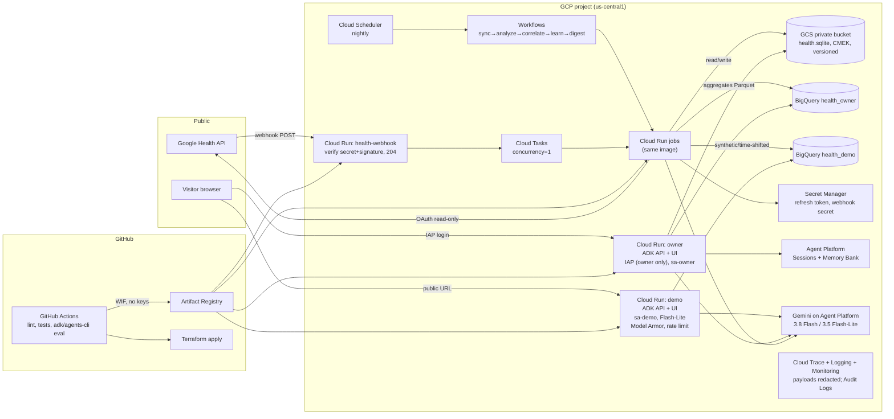

# 03 - Google Cloud Reference Architecture for a Personal Health Multi-Agent App (late 2026)

Research date: 2026-10-20. Scope: where to host the ADK multi-agent system (orchestrator + 3 specialists), the data layer, scheduled and event-driven ingestion, security and privacy for real personal health data behind a public demo, observability and evals, IaC/CI/CD, Gemini models and pricing. Also a recommended architecture, a cost table, the skills it demonstrates, and cost traps.

## Evidence posture labels

| Label | Meaning |
|---|---|
| **[PRIMARY]** | Read directly from official Google docs, pricing pages, release notes, or a Google-published PDF in this session |
| **[CORROBORATED]** | Two or more independent secondary sources agree; primary not fetched or not readable |
| **[SINGLE]** | One secondary source only. Treat as provisional |
| **[INFERENCE]** | My judgment from the evidence, or long-standing GCP behavior I did not re-verify this session |

Dates are as shown on the source. "n.d." means the page showed no date.

---

## TL;DR

1. **Naming changed.** On **2026-04-22**, Vertex AI became the **Gemini Enterprise Agent Platform**, and **Vertex AI Agent Engine became "Agent Runtime."** Sessions and Memory Bank became "Agent Platform Sessions" and "Agent Platform Memory Bank." The Gen AI evaluation service became "Gen AI evals." The API resource is still `ReasoningEngine`. [PRIMARY: https://docs.cloud.google.com/gemini-enterprise-agent-platform/release-notes]
2. **Host the agent on Cloud Run, not Agent Runtime or GKE.** Cloud Run gives you a browser-reachable demo URL, scale-to-zero, a free tier that covers demo traffic, IAP without a load balancer (**GA 2026-03-13**), and Cloud Run *jobs* for the batch loops from the same image. Optionally use Agent Platform Sessions/Memory Bank as managed backends (`agentengine://` URIs). If you want a second deployment target to show portability, deploy the same agent to Agent Runtime within its free allowance. [INFERENCE from PRIMARY sources below]
3. **Data: keep SQLite as the system of record, and add a BigQuery analytical mirror.** BigQuery is free at this scale (10 GiB storage, 1 TiB query/month). It unlocks the ADK `BigQueryToolset` (`forecast` via `AI.FORECAST`/TimesFM, `detect_anomalies`, `ask_data_insights` via Conversational Analytics) and vector search. That is the most skill per dollar. Cloud SQL (~$9-11/mo minimum) and AlloyDB are not worth it here. [PRIMARY + INFERENCE]
4. **Ingestion: Cloud Scheduler → Workflows → Cloud Run jobs** for the sync/analyze/correlate/learn/digest chain, all inside free tiers. **The Google Health API now has webhooks** (signal-only, HTTPS POST, signed, retried for 7 days). That enables an event-driven stretch path: webhook receiver on Cloud Run → Cloud Tasks (concurrency 1) → incremental sync job. There is no native Pub/Sub delivery. [PRIMARY: https://developers.google.com/health/webhooks]
5. **Privacy posture:** the public demo serves a **synthetic/time-shifted, aggregate-only DB**, never the real file. Owner mode sits behind **IAP**. Also: dedicated service accounts, Secret Manager for the OAuth refresh token, Model Armor (2M tokens/month free), Data Access audit logs, **trace payload capture turned off**, and a **Cloud Billing spend cap**. VPC-SC needs an Organization and is overkill. [PRIMARY + INFERENCE]
6. **OAuth gotcha:** in "Testing" mode, Google Health API refresh tokens **expire after 7 days**, which silently breaks scheduled syncs. Publish the consent screen to "In Production". Unverified apps are capped at 100 users, which is fine for personal use. [PRIMARY: https://developers.google.com/health/setup]
7. **Models (pricing page last updated 2026-10-19):** use **Gemini 3.5 Flash-Lite** ($0.30/$2.50 per 1M tokens) for specialists and batch loops, and **Gemini 3.8 Flash** ($0.75/$3.75, **doubling to $1.50/$7.50 on 2027-01-01**) for the orchestrator. Use **Gemini Embedding 2** ($0.20/1M text). Never send real health data through the **free tier**, because that data is "used to improve our products". [PRIMARY: https://ai.google.dev/gemini-api/docs/pricing]
8. **Google's recommended path is now `agents-cli`.** Agent Starter Pack is in maintenance mode. `agents-cli scaffold enhance --deployment-target cloud_run` plus `agents-cli infra setup-cicd` (Terraform; GitHub Actions or Cloud Build) is the official route. [PRIMARY/CORROBORATED]
9. **Expected monthly cost at demo scale: about $1-$15.** Gemini tokens make up almost all of it. Everything else fits in free tiers if you avoid the traps in Section 10.

---

## 1. Agent hosting

### 1.1 Options, current facts

| Option | Key facts (late 2026) | Posture |
|---|---|---|
| **Agent Runtime** (ex-Agent Engine) | Managed runtime for ADK, LangGraph, A2A, LlamaIndex, and custom agents. Supports VPC-SC, CMEK, data residency, HIPAA, Access Transparency/Approval. Agent identity (IAM), Agent Gateway routing, PSC interfaces, bidi streaming. "Sub-second cold starts" and long-running operations of up to 7 days (2026-04-22). Agent Observability GA, with tracing on by default for new ADK deployments (2026-06-18). GenAI metrics to Cloud Monitoring with ADK ≥ 2.6.0 (2026-08-13). | [PRIMARY: https://docs.cloud.google.com/agent-builder/agent-engine/overview, release notes above] |
| Agent Runtime pricing | **SKU consolidation:** Agent Platform Compute **$0.085/vCPU-hr**, Memory **$0.009/GiB-hr**, Storage **$0.30/GiB-mo**. New SKUs visible from 2026-06-17. Sessions (was $0.25/1K events) and Memory Bank retrieval (was $0.50/1K) move to the Compute unit ("each vCPU-hr can process 3M read or 1M write operations"), effective **2026-09-01**. Memory Bank stored memories (was $0.25/1K/mo) move to Storage. Embedding usage is billed at the chosen embedding model's price. | [PRIMARY: Google price-sheet PDF https://services.google.com/fh/files/emails/b_502770571_gemini_enterprise_agent_platform_pricing.pdf ; release note 2026-09-01] |
| Agent Runtime free tier | 50 vCPU-hr and 100 GiB-hr per month free. Idle time between turns is reportedly not billed with min_instances=0. One dev reports about 4.7 s extra first-request latency after idle at min 0. | [CORROBORATED for free tier: https://www.betterclaw.io/blog/google-vertex-ai-agent-builder , https://claw.aguidetocloud.com/google/vertex-ai-agents/overview/ ; SINGLE for idle latency: https://github.com/AshminPy/sre-agent-gateway/pull/256] |
| **Cloud Run** | Free tier: 2M requests, 180,000 vCPU-s, 360,000 GiB-s per month (request-based billing). Scales to zero. **IAP directly on Cloud Run GA 2026-03-13** (no load balancer). Worker pools GA 2026-04-14. Remote MCP server GA 2026-04-15. Ephemeral disk volumes Preview 2026-04-20. Sandboxes Preview 2026-07-08. Agent Identities Preview 2026-09-01. **Budget spend caps to pause Cloud Run workloads GA 2026-10-12.** ADK entrypoint detection in Python buildpack GA 2026-01-22. | [PRIMARY: https://docs.cloud.google.com/free/docs/free-cloud-features ; https://docs.cloud.google.com/run/docs/release-notes] |
| `adk deploy cloud_run` | Flags: `--with_ui`, `--session_service_uri` (`agentengine://`, `memory://`, any SQLAlchemy URL such as `sqlite+aiosqlite`), `--artifact_service_uri` (`gs://`), `--memory_service_uri` (`rag://`, `agentengine://`), `--allow_origins`. Extra gcloud flags go after `--`. Without session/artifact URIs, state is lost when an instance recycles. | [PRIMARY: https://adk.dev/deploy/cloud-run/ (n.d., 2026 footer)] |
| **GKE** | `agents-cli` supports `gke` as a target. Autopilot's cluster fee is normally offset by the GKE free-tier credit for one cluster, but you still pay for pods, and there is no scale-to-zero for the control-plane experience. | [PRIMARY for target: https://google.github.io/agents-cli/cli/ ; INFERENCE for cost] |
| **Gemini Enterprise registration** | `agents-cli publish gemini` registers agents with Gemini Enterprise. It requires a Gemini Enterprise subscription, reported at about $21+/seat/month (Business). Not worth it for a personal portfolio. A screenshot-level mention in the README is enough. | [PRIMARY for command; SINGLE for price: https://coworker.ai/blog/gemini-enterprise-pricing] |

### 1.2 Verdict

**Cloud Run is the primary host** [INFERENCE]:
- It serves a real HTTPS URL to browsers, so the custom frontend (AG-UI/Next.js or ADK web) and the API can share a service. An Agent Runtime endpoint is a Google API that needs OAuth bearer tokens, so you would still need a Cloud Run frontend in front of it.
- The demo traffic (hundreds of turns/month at ~10-30 s each) uses under 5% of the free vCPU-seconds.
- The same container image doubles as Cloud Run **jobs** for the batch loops.
- IAP-on-Cloud-Run gives owner-only access for free.

**Agent Runtime as a showcase, not a dependency:** create one Agent Runtime instance to back **Agent Platform Sessions + Memory Bank** for owner mode (`--session_service_uri agentengine://...`, `--memory_service_uri agentengine://...`). Optionally `agents-cli deploy --deployment-target agent_runtime` the same agent as a second target. At this scale both stay within the free compute allowance and cost cents in storage. **Note:** Sessions/Memory Bank global endpoints went GA 2026-06-17, but **CMEK cannot be used with the global endpoint**. Use a regional endpoint if you claim CMEK. [PRIMARY: release notes]

**Skip GKE.** It adds cost and ops for no visible benefit at one user. [INFERENCE]

---

## 2. Data layer

| Option | Tiny-scale cost | Fit | Posture |
|---|---|---|---|
| **SQLite on GCS** (download to local disk at start) | ~$0. 5 GB-month free in us-east1/us-west1/us-central1 | Keeps the existing substrate and tests. Single writer. | [PRIMARY free tier] |
| SQLite **directly on a GCS FUSE mount** | ~$0 | **Avoid for writes.** No file locking, last-writer-wins, not fully POSIX. Read-only immutable access is tolerable, but copying to local disk is safer. | [PRIMARY: https://docs.cloud.google.com/run/docs/tutorials/network-filesystems-fuse ; INFERENCE re SQLite] |
| **BigQuery** | **$0**: 10 GiB storage + 1 TiB queries/month free | ADK `BigQueryToolset` (ADK Python ≥1.1.0): `execute_sql`, `forecast` (AI.FORECAST/TimesFM), `detect_anomalies` (ARIMA_PLUS), `analyze_contribution`, `ask_data_insights` (Conversational Analytics API), `search_catalog`. `WriteMode.BLOCKED` enforces read-only. TimesFM 3.0 multivariate forecasting Preview (BigQuery notes 2026-10-07). Conversational Analytics in BigQuery GA, and can call AI.FORECAST/AI.DETECT_ANOMALIES in chat. | [PRIMARY: https://adk.dev/integrations/bigquery/ ; CORROBORATED: https://cloud.google.com/blog/products/data-analytics/conversational-analytics-in-bigquery-now-ga , https://docs.cloud.google.com/bigquery/docs/release-notes] |
| BigQuery vector search | Within free query tier at kilobyte-to-MB scale | Use for journal/insight/memory embeddings. `VECTOR_SEARCH` has been GA since 2024. | [INFERENCE: prior knowledge, not re-verified] |
| Firestore (+ vector search) | Free: 1 GiB, 50K reads/20K writes per day | Fine for session/UI state, but weak for time-series analytics. Shows little. | [PRIMARY free tier] |
| Cloud SQL Postgres + pgvector | **~$8-10/mo** db-f1-micro compute + storage. Shared-core has no SLA or CUDs. | Real skill, but a fixed monthly cost for one user. ADK `DatabaseSessionService` can use it (`agents-cli --session-type cloud_sql`). | [CORROBORATED: https://www.bytebase.com/dbcost/cloudsql/instance/db-f1-micro/ , https://www.usage.ai/blogs/gcp/cloud-sql/pricing/] |
| AlloyDB | Far above budget outside trials | Skip. | [INFERENCE] |

**Recommendation** [INFERENCE]: SQLite stays the system of record, stored privately in GCS (versioned bucket) and copied to local disk by jobs and the owner service. A nightly job exports **daily aggregates** (not raw intraday samples) as Parquet to BigQuery dataset `health_owner`, plus a separate `health_demo` dataset of synthetic/time-shifted aggregates. The "Data Scientist" specialist gets `BigQueryToolset(write_mode=BLOCKED)` scoped by IAM to the dataset for its mode. This shows SQL, BQML/TimesFM forecasting, anomaly detection, vector search, and Conversational Analytics, all for $0.

---

## 3. Scheduled and event-driven pipelines

| Component | Cost | Notes | Posture |
|---|---|---|---|
| **Cloud Scheduler** | 3 jobs free per *billing account*, then $0.10/job/month. Executions are free. | One nightly trigger is enough when Workflows chains the steps. Paused jobs may still count. | [CORROBORATED: https://cloud.google.com/scheduler/pricing] |
| **Cloud Run jobs** | Shares the Cloud Run free tier | Run `sync`, `analyze`, `correlate`, `learn`, `digest` as tasks of one image with different args. "Delayed job execution" (defer up to 12 h, cheaper) Preview 2026-09-08. | [PRIMARY: run release notes] |
| **Workflows** | 5,000 internal steps + 2,000 external HTTP calls free/month | Chains the jobs with retries and conditional steps (e.g., skip `learn` if `sync` fetched nothing). A nice visible DAG for the README. | [PRIMARY free tier] |
| Pub/Sub | 10 GiB/month free | Fan-out of "digest ready" events, e.g. a notification function. | [PRIMARY free tier] |
| Cloud Tasks | Generous free ops (not re-verified) | `max_concurrent_dispatches=1` serializes writes to the single-writer SQLite. | [INFERENCE] |
| **Cloud Composer** | Hundreds of $/month minimum | **Trap. Do not use.** | [INFERENCE] |

**Google Health API webhooks** [PRIMARY: https://developers.google.com/health/webhooks ; https://developers.google.com/health/release-notes]:
- Public HTTPS endpoint (TLS 1.2+). On subscriber create/update, two verification POSTs are sent: the one with your secret must get 200/201, and the one without it must get 401/403.
- Every notification carries your `secret` in `Authorization` plus a `GOOGLE-HEALTH-API-SIGNATURE` (ECDSA P-256/SHA-256, verifiable with Tink, keys rotate every 30 days).
- Payloads are **signals only** (`healthUserId`, `dataType`, `UPSERT|DELETE`, intervals), in batches of up to 99. Return **204** quickly and process asynchronously. Make the handler idempotent.
- Retried with backoff and stored up to **7 days**.
- Covers most types: steps, distance, floors, exercise, heart rate, HRV, resting HR, SpO2, respiratory rate, sleep, weight, body fat, nutrition, hydration, VO2 max, and more. Notifications fire only for granted scopes.
- `AUTOMATIC` subscriptions (2026-04-14). Manual subscription CRUD (2026-05-26). Delivery attempts logged in Cloud Logging.
- **No Pub/Sub delivery option.**
- Context: v4beta channel opened 2026-10-01. The Fitbit Web API turns off **2026-10-30**.

**Pattern** [INFERENCE]: `health-webhook` Cloud Run service (public, unauthenticated at the IAM layer, but verifies secret + signature in code) → enqueue a Cloud Task (dedupe key = dataType+interval) → `ingest` Cloud Run service/job runs incremental sync for that dataType/interval → optionally publishes `data.updated` to Pub/Sub → triggers `analyze` for the day. Keep the nightly Scheduler→Workflows run as the reconciliation backstop. Build this as Phase 2. It is a strong "event-driven architecture" talking point, but optional.

---

## 4. Security and privacy (real personal health data + public demo)

### 4.1 Controls, cost, and whether to use them

| Control | Use? | Notes | Posture |
|---|---|---|---|
| **IAP on Cloud Run (direct)** | **Yes**, owner service | GA 2026-03-13. No load balancer cost. Allow only your Google account. IAP can't be enabled on both the service and an LB. Incompatible with Cloud CDN. | [PRIMARY: run release notes; https://docs.cloud.google.com/iap/docs/enabling-cloud-run] |
| Identity Platform | Optional | Only if you want visitor sign-in for the demo. IAP + public demo is simpler. | [INFERENCE] |
| **Secret Manager** | **Yes** | OAuth client secret, Health API refresh token, webhook secret. Free: 6 active versions, 10K access ops/month. | [PRIMARY free tier] |
| **OAuth consent "In Production"** | **Yes, critical** | Testing mode means 7-day refresh tokens. Unverified clients are capped at 100 users. The setup page now steers to a **Web Server** client. Desktop flow still works for a one-time local consent, after which you store the refresh token. One secondary source lists the Health API among *restricted* scopes. Expect the unverified-app warning screen. | [PRIMARY: https://developers.google.com/health/setup ; SINGLE for restricted: https://www.agenticfabriq.com/blog/google-oauth-verification-casa] |
| **Dedicated service accounts** | **Yes** | `sa-demo` (reads only `health_demo` + demo bucket), `sa-owner`, `sa-ingest` (Secret Manager accessor for the token + bucket writer), `sa-deployer` (WIF). Least privilege is the cheapest credible control. | [INFERENCE] |
| **CMEK (Cloud KMS)** | Optional, cheap | A key costs cents/month (prior knowledge). Apply it to the private bucket + BigQuery owner dataset for a "defense in depth" line. Not usable with the Sessions/Memory Bank *global* endpoint. | [PRIMARY for global-endpoint caveat; INFERENCE for cost] |
| VPC Service Controls | **No** | Requires an Organization resource. Personal Gmail projects usually lack one. Overkill. | [INFERENCE] |
| **Model Armor** | **Yes**, public demo | **2M tokens/month free, then $0.10/1M.** Prompt-injection, jailbreak, and sensitive-data filters. Wire it as an ADK before/after-model callback (or via Agent Gateway, GA 2026-06-24). | [CORROBORATED: https://cloud.google.com/security/products/model-armor , https://austa.ai/articles/google-model-armor-pricing-limits-2026/ ; PRIMARY for Agent Gateway] |
| **Sensitive Data Protection (DLP)** | Yes, offline | Use de-identification transforms such as date-shifting, generalization, and free-text journal redaction when *building* the demo dataset in a job. Don't run it on every request. | [INFERENCE] |
| **Cloud Audit Logs** | **Yes** | Enable **Data Access** logs for GCS, BigQuery, and Secret Manager on owner resources. Free within the 50 GiB logging allotment. | [PRIMARY logging free tier; INFERENCE config] |
| **Trace payload redaction** | **Yes, critical** | Set `ADK_CAPTURE_MESSAGE_CONTENT_IN_SPANS=false` on Cloud Run (the default is only set for Agent Runtime deploys), and leave `OTEL_INSTRUMENTATION_GENAI_CAPTURE_MESSAGE_CONTENT` off. Otherwise health values land in Cloud Trace. | [PRIMARY: https://adk.dev/integrations/cloud-trace/] |
| **Spend caps + budgets** | **Yes** | Cloud Billing spend-cap budgets block new usage of a service at 100% (alerts at 50/80%). Enforcement lags by minutes, and they don't stop persistent resources. Also set Cloud Run `max-instances`, per-IP rate limiting, and a per-day token budget in the app. | [CORROBORATED: https://docs.cloud.google.com/billing/docs/how-to/budgets-spend-caps , https://firebase.google.com/docs/projects/billing/spend-caps ; PRIMARY run note 2026-10-12] |
| Paid Gemini only | **Yes** | Free-tier Gemini API data is "used to improve our products". The paid tier and Vertex are not. Use Vertex/Agent Platform with ADC, not a free AI Studio key, for real data. | [PRIMARY: pricing page] |

### 4.2 Demo mode vs owner mode

```
Public demo (no login)                      Owner mode (IAP: owner only)
-----------------------                     -----------------------------
Cloud Run svc "demo"                        Cloud Run svc "owner"
  sa-demo                                     sa-owner
  DB: demo.sqlite baked into image /          DB: real health.sqlite from private
      health_demo BQ dataset                      GCS (CMEK) + health_owner BQ
  Data: synthetic twin fitted to real         Data: real, full resolution
    distributions + time-shifted,
    aggregate-only (daily), k-anon bins
  Model: Flash-Lite, capped tokens/day        Model: Flash orchestrator
  Model Armor on in/out                       Model Armor on (cheap)
  Sessions: in-memory / SQLite (ephemeral)    Sessions/Memory: Agent Platform
  Read-only tools, WriteMode.BLOCKED          Read-only Health API by construction
  max-instances=2, rate-limited               max-instances=1
```

The two modes are separate services with separate service accounts, so a prompt injection in the demo **cannot** reach real data. IAM, not prompt rules, enforces the boundary. Say so in the README; it is the strongest security talking point. [INFERENCE]

**Credible non-HIPAA posture statement** [INFERENCE]: "Personal-use project, not a covered entity. Uses HIPAA-eligible services where practical (Agent Runtime lists HIPAA support), encryption at rest (optionally CMEK), least-privilege service accounts, IAP for PHI-equivalent data, audit logs, no PHI in traces/logs, paid-tier models only, public demo on synthetic/de-identified data." Do not claim HIPAA compliance, because there is no BAA.

---

## 5. Observability and evals

| Piece | Facts | Cost | Posture |
|---|---|---|---|
| ADK tracing | ADK follows the OTel GenAI semantic conventions. Agent Runtime: `adk deploy agent_engine --otel_to_cloud` (or `AdkApp(enable_tracing=True)`). Cloud Run: configure exporters in code with `google_cloud.get_gcp_exporters(enable_cloud_tracing=True)` + `maybe_set_otel_providers`. | - | [PRIMARY: https://adk.dev/integrations/cloud-trace/ ; https://adk.dev/observability/traces/] |
| OTel GenAI semconv | Moved to a dedicated `semantic-conventions-genai` repo (main repo v1.42.0, 2026-06-12). Still "Development" status as of mid-July 2026. Agent-level attribute names are the most likely to change. | - | [CORROBORATED: https://dev.to/azena-ai/opentelemetrys-genai-semantic-conventions-are-not-stable-yet-heres-what-actually-shipped-in-2026-3mke , https://greptime.com/blogs/2026-05-09-opentelemetry-genai-semantic-conventions] |
| Cloud Trace | First **2.5M spans/month free**, then $0.20/1M | $0 | [CORROBORATED: https://cloud.google.com/products/observability/pricing] |
| Cloud Logging | First **50 GiB/project/month** free. Default retention free. | $0 | [PRIMARY free tier] |
| Agent Observability | GA 2026-06-18. Payloads stored in GCS by default. Agent Runtime GenAI metrics → Cloud Monitoring (ADK ≥ 2.6.0, `GOOGLE_CLOUD_AGENT_ENGINE_ENABLE_TELEMETRY`). Feedback service (thumbs up/down → Cloud Trace) Preview 2026-07-29. | ~$0 | [PRIMARY: release notes] |
| BigQuery Agent Analytics | ADK plugin streams agent events to BigQuery for SQL dashboards. Pairs naturally with the BQ mirror. | $0 at scale | [INFERENCE: from agents-cli observability skill scope] |
| Evals | `agents-cli eval run/grade/compare/optimize`, plus `dataset synthesize` and `adk eval` with evalsets (tool-trajectory + LLM-judge). **Gen AI evals** (Agent Platform) for managed judge metrics. I found no published per-call price, so assume you pay the judge model's tokens. | Judge tokens only: cents per run on Flash-Lite | [PRIMARY: https://google.github.io/agents-cli/cli/ ; evals doc https://docs.cloud.google.com/gemini-enterprise-agent-platform/optimize/evaluation/evaluate-agents ; INFERENCE on cost] |

**Recommendation** [INFERENCE]: Run evals in CI on every PR against the **demo dataset** (deterministic, no secrets), and publish an eval scorecard table in the README. Export traces to Cloud Trace with payloads redacted. Build a Looker Studio or BigQuery-backed "agent ops" page showing latency, tokens, and cost per turn.

---

## 6. IaC and CI/CD

| Item | Recommendation | Posture |
|---|---|---|
| **Google's current path** | `agents-cli` (google/agents-cli). Commands: `scaffold create/enhance/upgrade`, `deploy`, `eval ...`, `infra single-project`, `infra setup-cicd`, `publish gemini`, `playground`, `run`, `lint`. Deployment targets `agent_runtime \| cloud_run \| gke`. CI/CD runners `google_cloud_build \| github_actions`. `--session-type in_memory \| cloud_sql \| agent_platform_sessions`. Terraform with a GCS remote backend; plan by default, `--apply` to apply. | [PRIMARY: https://google.github.io/agents-cli/cli/] |
| Agent Starter Pack | **Maintenance mode**, critical fixes only. New projects should use agents-cli. Migration: `setup-cicd` → `infra setup-cicd`; config moves to `agents-cli-manifest.yaml`. | [PRIMARY: https://github.com/GoogleCloudPlatform/agent-starter-pack ; https://google.github.io/agents-cli/reference/from-agent-starter-pack/] |
| Existing repo | Use `agents-cli scaffold enhance --deployment-target cloud_run` (not `create`) to add deploy/CI scaffolding to the existing ADK code. | [CORROBORATED: https://docs.cloud.google.com/gemini-enterprise-agent-platform/agents/quickstart-adk , https://adk.dev/deploy/agent-runtime/agents-cli/] |
| Terraform vs Pulumi | **Terraform.** It is what agents-cli generates, what most GCP job posts list, and what has the deepest `google`/`google-beta` provider coverage. Pulumi is fine but lower signal here. | [INFERENCE] |
| CI | **GitHub Actions + Workload Identity Federation** (`google-github-actions/auth`, `id-token: write`, principalSet restricted to `attribute.repository`). No JSON keys. Push images to **Artifact Registry** (0.5 GB free; add a cleanup policy). Cloud Build: 2,500 build-min/month free if you prefer it. I could not confirm whether agents-cli's GitHub Actions template wires WIF automatically. Verify with `infra setup-cicd --help`. | [CORROBORATED for WIF pattern: https://xebia.com/blog/setup-keyless-authentication-to-google-cloud-for-github-actions-using-terraform-2/ ; PRIMARY free tiers] |

---

## 7. Gemini models and pricing (Gemini API pricing page, last updated 2026-10-19)

[PRIMARY: https://ai.google.dev/gemini-api/docs/pricing ; https://ai.google.dev/gemini-api/docs/deprecations ; rate limits page updated 2026-10-15 says free-tier limits are shown only in AI Studio]

| Model | Input / Output per 1M (Standard) | Cache | Batch | Free tier | Role here |
|---|---|---|---|---|---|
| Gemini 4 Argon | $2.00 / $10.00 → **$4.00 / $20.00 from 2026-12-01** | $0.10 | 50% | No | Skip (cost) |
| Gemini 3.8 Flash | $0.75 / $3.75 → **$1.50 / $7.50 from 2027-01-01** | $0.075 | $0.375 / $1.875 | Yes | Orchestrator |
| Gemini 3.6 Flash | same as 3.8 Flash, same doubling | $0.075 | same | Yes | Alt |
| **Gemini 3.5 Flash-Lite** | **$0.30 / $2.50** | $0.03 | $0.15 / $1.25 | Yes | Specialists, batch loops, demo |
| Gemini 3.1 Flash-Lite | $0.25 / $1.50 | $0.025 | $0.125 / $0.75 | Yes | Cheapest current. Earliest retirement 2027-05-07 → 3.5 Flash-Lite |
| Gemini 3.1 Pro Preview | $2.00 / $12.00 (≤200k) | $0.20 | $1.00 / $6.00 | No | Occasional deep weekly digest only |
| Gemini 2.5 Flash / Flash-Lite / Pro | $0.30/$2.50; $0.10/$0.40; $1.25/$10 | | | Yes | **Legacy.** Access is limited to recent users. Don't build new on these. |
| **Gemini Embedding 2** | $0.20 / 1M text (batch $0.10) | | | Yes | Embeddings. `gemini-embedding-001` retires 2028-05-14. |

- **Grounding with Google Search (Gemini 3+):** 5,000 requests/month free, then $14/1K.
- **Context caching:** worth it for the large, stable system prompts and tool schemas shared by the 4 agents. Storage is billed hourly (e.g., $1.00/1M tokens/hour for Flash-Lite), so use implicit caching or short TTLs.
- **Batch/Flex ≈ 50% off.** The nightly `learn`/`digest` loops are ideal for Batch. Agent Platform also has a **deferred tier (Preview 2026-09-02)** with a 50% discount for background workloads. [PRIMARY: release notes]
- **Vertex/Agent Platform vs AI Studio key:** Per-token prices are essentially the same. Use **Agent Platform with ADC (service-account identity, no API keys)** in the cloud for IAM, audit logs, and data terms. An AI Studio key is fine for local prototyping on *synthetic* data only. The $300 trial credit **cannot** pay for Gemini API in AI Studio. [PRIMARY: free-tier page]
- **Price-change risk:** Flash doubles on 2027-01-01. Make the model ID a config value per agent so you can drop to Flash-Lite without code changes. [INFERENCE]

---

## 8. Recommended reference architecture



ASCII fallback:

```
 Visitor ──► [Cloud Run demo] ──► BigQuery health_demo ──► Gemini 3.5 Flash-Lite
                (Model Armor, rate limit, sa-demo)
 Owner ──IAP─► [Cloud Run owner] ──► GCS health.sqlite + BigQuery health_owner
                                  └► Agent Platform Sessions/Memory Bank ──► Gemini 3.8 Flash
 Scheduler ─► Workflows ─► Cloud Run jobs (sync/analyze/correlate/learn/digest)
 Google Health webhooks ─► [Cloud Run health-webhook] ─► Cloud Tasks(1) ─► sync job
 Secret Manager (refresh token) · Cloud Trace/Logging (no payloads) · Audit Logs · Spend cap
 GitHub Actions ─WIF─► Artifact Registry + Terraform (agents-cli infra setup-cicd)
```

**Phasing** [INFERENCE]:
1. **Phase 1 (1 weekend):** `agents-cli scaffold enhance` → Cloud Run demo + owner (IAP) with Terraform, GitHub Actions + WIF, Secret Manager, Scheduler→Cloud Run job nightly sync, spend cap.
2. **Phase 2:** BigQuery mirror + `BigQueryToolset` (forecast/anomalies), Workflows DAG, Cloud Trace + eval CI scorecard.
3. **Phase 3:** Health API webhooks → Cloud Tasks; Agent Platform Sessions/Memory Bank; Model Armor; optional Agent Runtime second target.

---

## 9. Monthly cost estimate (demo scale)

Assumptions [INFERENCE]: 300 chat turns/month across demo + owner, about 4 model calls/turn at ~8K input + ~1K output tokens each; 30 nightly pipeline runs at ~100K tokens each; DB 480 MB; images ~1 GB.

| Item | Usage | Free tier | Est. $/mo |
|---|---|---|---|
| Cloud Run services (demo, owner, webhook) | ~10K vCPU-s | 180K vCPU-s, 2M req | **$0** |
| Cloud Run jobs (pipeline) | ~10-20K vCPU-s | shared | **$0** |
| Cloud Scheduler | 1-2 jobs | 3 free/billing acct | $0 |
| Workflows | ~300 steps | 5K steps | $0 |
| Cloud Tasks / Pub/Sub | trivial | free tiers | $0 |
| GCS (us-central1) | ~1-2 GB incl. versions | 5 GB-mo | $0 |
| BigQuery | <1 GiB, <10 GiB scanned | 10 GiB / 1 TiB | $0 |
| Artifact Registry | ~1-2 GB | 0.5 GB | $0.05-0.15 |
| Secret Manager | 3-6 versions | 6 versions, 10K ops | $0-0.30 |
| Cloud KMS (optional CMEK) | 1-2 keys | none | ~$0.06-0.12 |
| Trace / Logging / Monitoring | <<2.5M spans, <<50 GiB | yes | $0 |
| Model Armor | <2M tokens | 2M tokens | $0 |
| Agent Platform Sessions/Memory Bank (optional) | tiny | 50 vCPU-hr / 100 GiB-hr (reported) + storage $0.30/GiB | $0-0.50 |
| **Gemini - all Flash-Lite 3.5** | ~12M in / 1.5M out | — | **~$7-8** |
| Gemini - Flash orchestrator + Flash-Lite specialists | mixed | — | ~$9-12 (≈$15-20 after 2027-01-01) |
| Gemini - pipeline loops via Batch | ~3M tokens | — | ~$0.50-1 |
| Embeddings (Gemini Embedding 2) | <1M tokens | — | <$0.20 |
| Cloud SQL (only if chosen instead of SQLite/BQ) | db-f1-micro | none | +$9-11 |
| Custom domain (optional) | — | — | ~$1 (amortized) |
| **Total (recommended stack)** | | | **≈ $1-15/mo**, set the spend cap at $20 |

At near-zero traffic the bill falls to about $1. The real risk is a public demo being scraped or abused, which is why the token budget, rate limit, max-instances, and spend cap matter more than any infra choice.

---

## 10. Cost traps and things to avoid

1. **Cloud Composer.** It has a large always-on minimum. Use Workflows. [INFERENCE]
2. **Cloud Run `min-instances>0` or instance-based billing.** Idle time is billed. Keep request-based billing at min 0. Accept the cold start, or set min 1 only on the demo during interviews. [CORROBORATED: https://docs.cloud.google.com/run/docs/configuring/min-instance]
3. **Agent Runtime with min_instances>0** keeps warm compute billing past the free 50 vCPU-hr. [SINGLE]
4. **Cloud SQL/AlloyDB "just for pgvector".** BigQuery vector search or in-SQLite vectors cost $0. [INFERENCE]
5. **SQLite writes over GCS FUSE.** No locking means corruption or lost writes. [PRIMARY]
6. **OAuth consent left in "Testing".** The 7-day refresh-token expiry silently kills nightly sync. [PRIMARY]
7. **Free-tier Gemini key with real data.** That data is used to improve products. [PRIMARY]
8. **Gemini Flash price doubling 2027-01-01** and **Gemini 4 Argon doubling 2026-12-01.** Keep model IDs configurable and default specialists to Flash-Lite. [PRIMARY]
9. **Context-cache storage left running.** It is billed per token-hour. [PRIMARY]
10. **Trace/log payload capture.** It puts health data into Cloud Trace/Logging, and long retention costs extra. [PRIMARY]
11. **External HTTPS Load Balancer + Cloud Armor** just to get IAP. It is no longer needed (IAP on Cloud Run GA). An LB costs roughly $18+/mo. [PRIMARY for IAP; INFERENCE for LB cost]
12. **Artifact Registry growth** from per-commit images. Add a cleanup policy. [INFERENCE]
13. **GKE / Vertex AI Vector Search (Agent Retrieval) / Vertex endpoints.** They carry always-on node or index charges. [INFERENCE]
14. **Cloud NAT / Serverless VPC connectors** added "for security". They have a fixed hourly cost and no benefit here. [INFERENCE]
15. **Gemini Enterprise registration** needs paid seats. Skip it. [SINGLE]
16. **Spend caps are not hard caps.** Enforcement lags by minutes and doesn't stop persistent resources. Pair them with app-level token budgets. [CORROBORATED]

---

## 11. GCP skills this demonstrates (resume/README list)

- **Agentic AI on GCP:** ADK multi-agent on Cloud Run; Agent Platform Sessions/Memory Bank; optional Agent Runtime deploy; `agents-cli` lifecycle (scaffold, eval, deploy, CI/CD).
- **Serverless:** Cloud Run services + jobs, IAP on Cloud Run, Cloud Scheduler, Workflows, Cloud Tasks, Pub/Sub, event-driven webhooks.
- **Data/AI:** BigQuery, BigQuery ML / `AI.FORECAST` (TimesFM), anomaly detection, vector search, Conversational Analytics via ADK `BigQueryToolset`, Gemini Embedding 2, Batch API / context caching cost engineering.
- **Security:** least-privilege service accounts, Workload Identity Federation (keyless CI), Secret Manager, CMEK/Cloud KMS, Model Armor, Sensitive Data Protection de-identification, audit logs, demo/owner isolation enforced by IAM.
- **Observability/quality:** OpenTelemetry GenAI tracing to Cloud Trace, Cloud Logging/Monitoring, eval-in-CI scorecards, BigQuery agent analytics.
- **Platform/FinOps:** Terraform, GitHub Actions, Artifact Registry, budgets + spend caps, free-tier-aware design with a documented monthly cost.

---

## Open questions / not verified this session

- The exact current Agent Runtime free-tier wording on the official pricing page (the page exceeded fetch limits; figures are from the Google PDF plus secondary sources).
- Whether `agents-cli infra setup-cicd --cicd-runner github_actions` provisions WIF automatically.
- Gen AI evals per-call pricing (no official figure found; assume judge-model tokens).
- Whether Google Health API scopes are formally "restricted" (CASA) vs "sensitive". This matters only beyond 100 users.
- Cloud Tasks and Cloud KMS current free/price figures (prior knowledge only).
