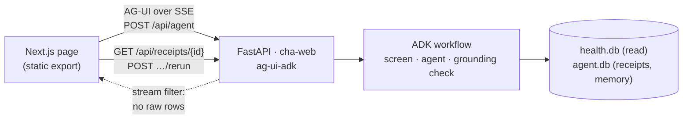

# The web app (Phase 5)

A page where you talk to the same agent as `cha ask`, watch it work, and open the receipt
behind every number. It adds no intelligence: the same ADK workflow, tools, guards, caps and
receipts, reached over the [AG-UI](https://docs.ag-ui.com) protocol.

## Run it

| Mode | Command | Data | Model |
|---|---|---|---|
| Laptop | `uv run cha-web` | your real `data/health.db` | Gemini on Vertex AI only (refuses a free-tier key) |
| Demo | `uv run cha-web --demo` | the synthetic eval fixture, with a "demo data" badge | any Gemini backend; use this for every screenshot |
| Test | `uv run cha-web --demo --test-model` | synthetic | a scripted model from `CHA_WEB_FAKE_SCRIPT` (end-to-end tests) |
| Cloud | Cloud Run `cha-web` (`--cloud`) | `health.db` read from the bucket | Vertex AI, as the service account |

Build the front end first: `cd apps/web && npm ci && npm run build`. Laptop and demo modes
listen on `127.0.0.1:8780` only.

## What the page does

- **Streams the answer** and shows each tool call as it happens (the "agent at work" timeline).
- **Receipt chips:** every receipt id opens a panel with what the code read, the code, the
  output, the as-of date and data hash, and a **Re-run** button (matches / differs / data changed).
- **Metric cards:** a receipt whose output is a date series becomes an inline chart, drawn to
  scale from the receipt's own rows.
- **Memory approval:** "Save a memory?" with Save / Don't save. Nothing is saved without Save.
- **Weather where you are:** "Use my location for weather" sends the device location (only
  latitude, longitude, place) for this session; otherwise the home location is used.
- **Scoreboard:** the forecast ledger's settled scores, with n beside every number and "not yet"
  below 10 paired days.
- **Installs on a phone** (manifest and an app-shell service worker).

## Security model

| Risk | Control |
|---|---|
| A page on another site reads the laptop server | Laptop and demo modes answer only on `127.0.0.1`/`localhost` (Host check) |
| Someone else reaches the cloud service | Cloud Run's built-in IAP: only the owner's Google account; the app also checks IAP's identity header against `CHA_WEB_OWNER_EMAIL` |
| Health data copied into the browser | The AG-UI stream is filtered: tool results become `{tool, receipt, status, n, error}`, state keeps only receipt ids; receipt data loads only on request. The service worker never caches `/api/*`; nothing is stored in local storage |
| The browser steers the agent through client state | Only a validated `location` (finite, in range, place trimmed) is copied into the session; every other key is dropped |
| Model text as markup | Markdown with raw HTML shown as text, no images, no outbound links |
| Injected script | CSP `default-src 'self'`, scripts from `'self'` plus the export's inline scripts by SHA-256 (no `unsafe-inline`), `frame-ancestors 'none'` |
| Runaway spend | Every model call counts against the monthly chat cap; a run past it ends with a plain-words error |
| Real data on a free-tier key | `cha-web` (laptop) refuses to start unless Gemini goes through Vertex AI |

## Tests

- Python: `tests/test_web_*.py` (agent over AG-UI, stream filter, routes, location, budget,
  security headers, cloud mode, infra), `tests/test_agent_db_sync.py`.
- Front end: `npm test` (Vitest: run reducer, chat screen, receipts, metric cards, PWA).
- End to end: `npm run e2e` (Playwright: demo server with a scripted model; desktop and phone,
  dark and light, axe with no serious or critical violations, no CSP errors). Runs in CI
  (`.github/workflows/web.yml`).

## Deploy (Cloud Run behind IAP)

1. `docker build -f apps/webservice/Dockerfile -t us-central1-docker.pkg.dev/<project>/cha/web:<sha> .`
   and `docker push` it.
2. Set `web_image` in `infra/terraform.tfvars`, then `terraform plan -out tfplan` and
   `terraform apply tfplan`.
3. Open the `web_url` output and sign in with the owner account; anyone else is refused.
